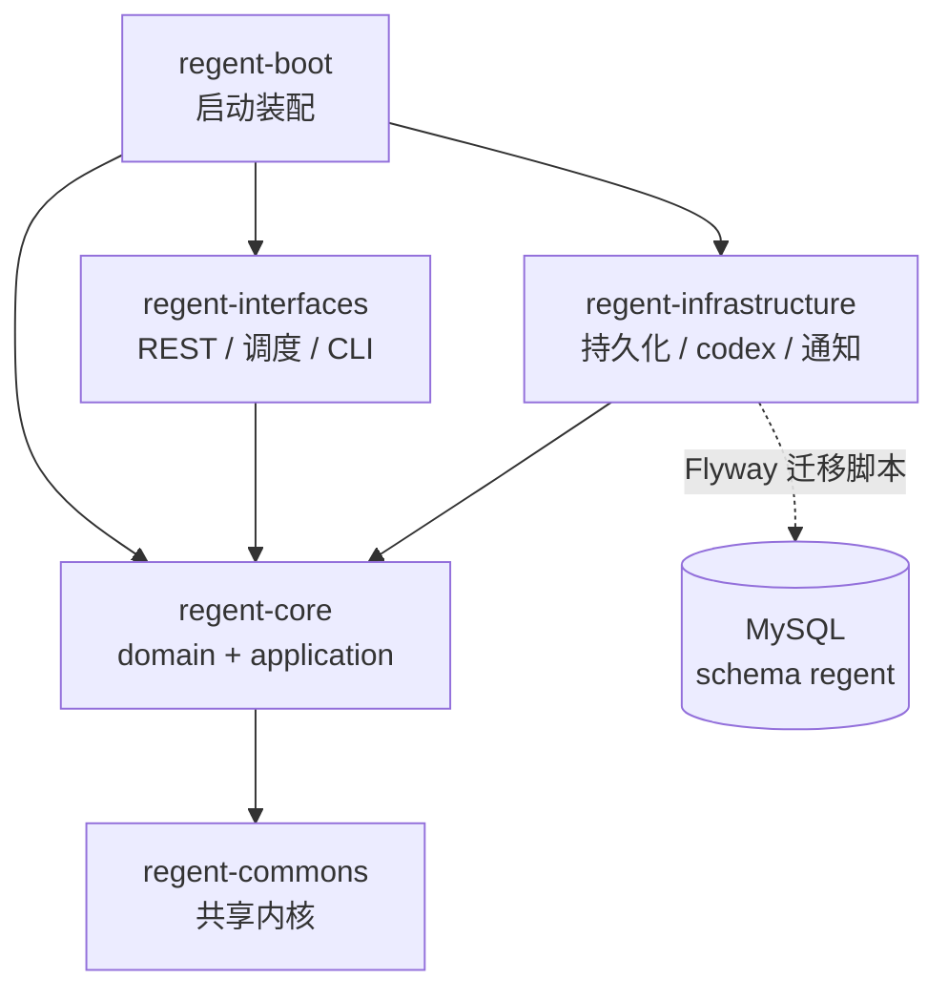

# Regent 架构与分包设计（DDD）

> 版本：v1.0
> 定义日期：2026-10-16
> 配套文档：`TECH_STACK.md`（技术栈）、`ARCHITECTURE.md`（本文档）
> 基础包名：`com.pydlove.regent`　groupId：`com.pydlove.regent`

---

## 一、战略设计：限界上下文与核心域

DDD 的第一步是回答「哪里值得投入最多精力」。这个平台的价值分布很不均匀：

| 限界上下文 | 域类型 | 职责 | 投入 |
|---|---|---|---|
| **`governance`** | **核心域** | 决策分级规则、仲裁「就高不就低」、决策单、审批令牌 | **最高**，唯一不能出错的地方 |
| `execution` | 支撑域 | 任务生命周期状态机、`codex exec` 调用、执行记录、事件流 | 高 |
| `requirement` | 支撑域 | 需求录入、拆解为任务 | 中 |
| `bug` | 支撑域 | 缺陷单、派生修复任务 | 中 |
| `project` | 支撑域 | 项目注册、项目画像（路径/验证方式/等级覆盖） | 中 |
| `plugin` | 支撑域 | 可复用能力包、不可变版本、任务固定版本绑定 | 中 |
| `testing` | 支撑域 | Web / 接口测试用例、任务完成后自动执行、独立测试记录 | 中 |
| `notification` | 通用域 | 邮件与推送投递、通道降级 | 低，能跑就行 |
| `settings` | 通用域 | 平台设置、中继服务器连接与安装、状态监听 | 低 |
| `shared` | 共享内核 | 值对象、领域事件基类、异常、ID | 低，但必须稳定 |

**为什么 `governance` 是核心域**：整件事的成败全压在「AI 该自己拍板还是该问你」这一个判断上。判错了轻则白干一轮，重则自动改坏东西。其余所有上下文都只是把数据搬到这个判断面前的管道。所以决策分级规则要设计得最细、测得分最透、演进得最谨慎。

**为什么 `notification` 是通用域**：发邮件和调 webhook 是任何系统都要做的事，没有领域特殊性，用现成轮子实现到「能用」即可，不要在这里花心思设计抽象。

---

## 二、战术设计：聚合与聚合边界

### 2.1 聚合根清单

| 聚合根 | 上下文 | 说明 |
|---|---|---|
| `Project` | `project` | 项目画像，含决策等级覆盖配置 |
| `EnvironmentEntry` | `project` | 可全局或按项目归属的任务执行环境信息（键值、标签、描述） |
| `Plugin` | `plugin` | 可复用代码/说明能力包，保存当前版本与启停状态 |
| `TestCase` | `testing` | Web / 接口测试用例，含执行命令、可选上传脚本与启停状态 |
| `TestCaseRun` | `testing` | 任务完成后的一次测试执行事实：退出码、摘要、输出与终态 |
| `Requirement` | `requirement` | 需求，持有 `List<TaskId>` **弱引用** |
| `Task` | `execution` | 执行单元，含状态机与 `codex_thread_id` |
| `TaskRun` | `execution` | 单次执行记录，token 消耗、分支名、退出码 |
| `Decision` | `governance` | 决策单，含「谁做的决定」与依据规则 |
| `DecisionRule` | `governance` | 分级规则（路径通配 / 关键词 / 项目级覆盖） |
| `Bug` | `bug` | 缺陷单，可派生修复任务 |
| `Notification` | `notification` | 投递记录 |
| `RelaySettings` | `settings` | 中继服务器连接、安装目录与状态监听开关；SSH 密码和共享密钥不进入领域模型 |

### 2.2 三个关键边界决策

**① `Task` 必须独立成聚合，不能塞进 `Requirement`。**

`Task` 是长时间运行、被执行器高频改状态的对象，生命周期远长于 `Requirement`。若把 Task 作为 Requirement 聚合内的实体，则每次「把某个任务标记为 RUNNING」都要加载整棵需求树并锁住整个聚合——执行器并行跑任务时直接互相打架。所以 `Requirement` 只持有 `List<TaskId>`，跨聚合通过 ID 弱引用。

**② `Decision` 独立于 `Task`。**

一个 Task 可能多次阻塞、产生多条决策。`Decision` 有自己的生命周期（待批 → 已批 → 已执行）和「谁批准的」这类审计属性。挂在 Task 下会让 Task 表变成一张巨宽的宽表。

**③ 单聚合内强一致，跨聚合最终一致。**

聚合内用领域方法守卫不变量；跨聚合（如「决策批准后 Task 解除阻塞」）**必须由应用服务显式编排**，不允许在 `Decision` 的方法里反手改 `Task`。这条是 DDD 最常被破坏的纪律。

### 2.3 任务状态机（领域不变量所在）

```
PENDING ──queue──▶ QUEUED ──dispatch──▶ RUNNING ──success──▶ DONE
   │                                      │
   └────────────dispatch──────────────────┘
                                          ├──platform restart──▶ QUEUED（保留 thread_id，重新派发）
                                          ├──needDecision──▶ BLOCKED ──approved──▶ RUNNING (resume)
                                          │                     │
                                          │                     └──rejected──▶ CANCELLED
                                          └──error──▶ FAILED ──retry──▶ PENDING
                                                                 CANCELLED ──retry──▶ PENDING
```

不可重开的终态只有 `DONE`。`FAILED` 与 `CANCELLED` 都可经人工操作回到 `PENDING`；
其中 `CANCELLED` 只是停止当前执行，不删除历史运行记录、分支或会话，重新执行时仍可接续原有上下文。

`QUEUED` 表示用户已提交执行、但尚未取得执行位；它不算一次执行尝试。状态迁移**只能通过领域方法**发生，
绝不允许 `task.setStatus(...)`：

平台重启后，内部 codex 进程已经不存在，普通 `RUNNING` 任务不能继续留在库里。启动恢复会把对应的
`task_run` 收敛为 `INTERRUPTED`，再由 `Task.requeueAfterInterruption()` 把任务放回 `QUEUED`。
恢复不绕过分支审批：原分支还在就直接复用，分支已不存在仍会生成 L2 审批；外部执行者的租约记录
不会被平台重启改写。

```java
public class Task extends AggregateRoot<TaskId> {

    private TaskStatus status;

    /** 排队等待执行位。 */
    public void queue() {
        requireState(TaskStatus.PENDING, "只有待执行任务可以进入排队");
        this.status = TaskStatus.QUEUED;
    }

    /** 派发执行。PENDING 与 QUEUED 都可派发。 */
    public void dispatch(BranchName branch) {
        requireStateIn("只有待执行或排队中的任务可以派发", TaskStatus.PENDING, TaskStatus.QUEUED);
        this.status = TaskStatus.RUNNING;
        this.branch = branch;
        registerEvent(new TaskStarted(this.id, branch, Instant.now()));
    }

    /** 执行中阻塞，等待人工决策。 */
    public void block(DecisionId decisionId, DecisionLevel level) {
        requireState(TaskStatus.RUNNING, "只有执行中的任务可以阻塞");
        this.status = TaskStatus.BLOCKED;
        this.blockingDecisionId = decisionId;
        registerEvent(new TaskBlocked(this.id, decisionId, level, Instant.now()));
    }

    /** 决策归位后续跑。 */
    public void resume(DecisionOutcome outcome) {
        requireState(TaskStatus.BLOCKED, "只有阻塞中的任务可以续跑");
        this.status = TaskStatus.RUNNING;
        this.appendContext("决策结果：" + outcome.freeText());
    }
}
```

### 2.4 值对象

不可变、用值相等、自带校验。至少要有：

`DecisionLevel`（L0–L3）、`ProjectPath`、`BranchName`、`ThreadId`、`TokenUsage`、`Severity`、`Reversibility`、`BlastRadius`、`TaskId` / `DecisionId` / `BugId` 等强类型 ID。

强类型 ID 不是形式主义：`TaskId` 和 `DecisionId` 都是 `Long` 时，传错参数编译器一声不吭；包成值对象后这类错误在编译期就挂了。

---

### 2.5 决策等级只升不降（刻意的设计约束）

分级规则**只能把等级往上抬，永远不能往下压**。`DecisionLevel.higherOf` 的存在就是为了让「降级」在代码层面根本写不出来。

理由是：执行器报出高等级，通常是因为它在改动内容里识别到了风险。如果允许一条路径通配就否掉这个判断，等于用正则表达式覆盖风险识别 —— 这是整个平台最危险的一个动作，而它换来的只是「少问你几次」。

因此配置里早期设计的 `auto-patterns`（自动降级白名单）**已取消，不实现**。若将来纯文档改动被误报为高等级、噪音确实成为问题，那应当作为独立设计引入，并同时满足三个约束：只能从 L2 降到项目阈值、L3 绝对不可降、全部改动必须落在白名单内，且配套专门测试。

配套的第二个约定：**规则配置非法时失败关闭**。通配表达式写错会抛 `DomainException` 让任务停下，而不是当作「未命中」跳过。跳过一条本该升级的规则会让决策被自动执行，代价远高于报错停下。

---


## 三、Maven 模块划分与依赖方向

### 3.1 为什么模块切得「粗」

**这里有个真实取舍，先说清楚。** 教科书式的 DDD 会给每个限界上下文一个独立 Maven 模块（`regent-governance`、`regent-execution`、`regent-bug`…）。但本项目大约 150–200 个类、五千到八千行，切成十几个模块会立刻带来：

- 改一处业务逻辑要跳五六个 `pom.xml`
- 全量编译变慢，IDE 索引和重构变迟钝
- 上下文之间的协作要经过一层层 `public` 暴露和依赖声明，噪音盖过收益

**结论：Maven 模块只承担「物理边界」职责，限界上下文用包来承载。** 模块边界只有一个目的——**强制领域层不依赖框架**。这是 DDD 里投入产出比最高的一条编译期约束，其余边界交给包约定 + 架构测试守。

### 3.2 六个模块

| 模块 | 内容 | 允许依赖 | 禁用 |
|---|---|---|---|
| `regent-commons` | `shared.*` 共享内核 | 仅 JDK | 任何框架 |
| `regent-core` | **所有上下文的 `domain` + `application` 包** | `regent-commons` | **Spring、MyBatis、Jackson、HTTP 全部禁用** |
| `regent-infrastructure` | 所有上下文的 `infrastructure` 包、MyBatis XML、**Flyway 迁移脚本** | `regent-core` | — |
| `regent-interfaces` | 所有上下文的 `interfaces` 包、REST、调度入口、CLI | `regent-core` | — |
| `regent-boot` | `main`、Spring 装配、`application-*.yml` | 全部 | — |
| `regent-relay` | 公网中继 server 与本地 connector，独立部署，不承载领域模型 | 仅 JDK | 不参与 DDD 依赖链，不访问数据库或领域对象 |

`regent-core` 是整套设计的腰眼：**它是纯 Java，可以脱离 Spring 和数据库直接用 JUnit 跑**。决策仲裁这种关键逻辑能在毫秒级单测里跑上百个用例，这是它必须纯净的唯一理由。

### 3.3 依赖方向



箭头只许向下，**不许出现反向依赖**。`regent-core` 不认识 Spring、不认识 MySQL、不认识 `codex` 命令，它只认自己定义的端口接口。

### 3.4 什么时候该把上下文升级成独立模块

记住这个判据，别提前优化：

- 需要**独立部署**（比如通知服务要单独横向扩）
- 需要**编译期禁止**两个上下文互相依赖（而不是靠自觉）
- 某上下文的依赖集与其他上下文**严重冲突**（比如引入了不同大版本的库）

三条都不满足，就继续用包。

---

## 四、目录结构

### 4.1 顶层目录（`regent/` 下）

```
regent/
├── .gitignore
├── .editorconfig
├── AGENTS.md                    # 给 Codex 的项目约定（本仓库由 Codex 开发，待写）
├── README.md                    # 待写
├── TECH_STACK.md                # 技术栈定义
├── ARCHITECTURE.md              # 本文档
├── pom.xml                      # 聚合 POM，<parent> 指向 api-parent
│
├── regent-commons/              # ┐
├── regent-core/                 # │
├── regent-infrastructure/       # ├─ 五个领域构建模块，内部结构见 4.2
├── regent-interfaces/           # │
├── regent-boot/                 # ┘
├── regent-relay/                # 独立部署模块，不参与 DDD 领域依赖链
├── regent-web/                  # 前端工程，独立于 Maven（待定 Vue/React）
│
├── doc/                         # 项目文档，集中于根目录
│   ├── 需求文档/
│   ├── 设计文档/
│   ├── 开发文档/
│   ├── 数据库文档/
│   ├── 测试文档/
│   └── bug/
├── openspec/                    # 规格驱动开发产物
│   ├── config.yaml
│   ├── specs/
│   └── changes/
├── deploy/                      # 运行守护：start-all / stop-all / restart / status
└── scripts/                     # 一次性运维与开发脚本
```

| 顶层项 | 职责 | 对齐来源 |
|---|---|---|
| `regent-*`（六个） | Maven 模块，唯一构建单元；其中 `regent-relay` 是独立部署工具 | `app_audit` 的多模块聚合 |
| `regent-web` | 前端 npm 工程，**不参与 Maven 构建** | `app-audit-frontend` 的独立工程形态 |
| `doc/` | 需求 / 设计 / 开发 / 数据库 / 测试 / bug 六类文档集中存放 | `app_audit/doc/` 同名同构 |
| `openspec/` | 规格驱动开发产物 | `app_audit`、`safe-guard`、`test_maf` |
| `deploy/` | 运行守护脚本 | `py-deploy` 的 start/stop/status 习惯 |
| `scripts/` | 一次性脚本，不进构建 | `nexis`、`test_maf` |

三条摆放规矩：

- **文档不散落在模块内。** 所有设计、需求、bug 记录集中在根目录 `doc/`，模块目录里只放代码和资源。跨模块评审要在同一个地方看得到全貌。
- **运行时数据一律不落仓库。** 日志、执行记录、本地配置全在 `~/.regent/`。**仓库里出现 `logs/` 或 `*.log` 即为配置错误**，`.gitignore` 已兜底，但那是安全网不是借口。
- **Flyway 迁移脚本的唯一位置是 `regent-infrastructure/src/main/resources/db/migration/`**，不是 `doc/数据库文档/`。

> **这里有一条需要刻意改变的旧习惯。** `app_audit` 历来把 `app_audit_update_3.2.5.sql` 这类升级脚本手工存放在 `doc/` 下维护。引入 Flyway 后**这个做法必须废止**：版本化 SQL 一旦有两个来源，`flyway_schema_history` 与真实表结构就会漂移，而漂移不会当场报错，只会在某个环境上突然炸。`doc/数据库文档/` 只放说明性内容（ER 图、字段解释、变更说明），不放可执行脚本。

### 4.2 模块与包结构

```
regent/
├── pom.xml                                   # 聚合 POM，<parent> 指向 api-parent
├── README.md
├── TECH_STACK.md
├── ARCHITECTURE.md
│
├── regent-commons/
│   └── src/main/java/com/pydlove/regent/shared/
│       ├── domain/                           # 基础构件
│       │   ├── AggregateRoot.java
│       │   ├── Entity.java
│       │   ├── ValueObject.java
│       │   ├── DomainEvent.java
│       │   ├── DomainException.java
│       │   └── Invariant.java
│       ├── kernel/                           # 通用值对象
│       │   ├── DecisionLevel.java            # L0–L3，核心域概念
│       │   ├── Severity.java
│       │   ├── ProjectPath.java
│       │   ├── BranchName.java
│       │   ├── ThreadId.java
│       │   └── TokenUsage.java
│       └── util/
│
├── regent-core/                              # 纯 Java，零框架依赖
│   └── src/main/java/com/pydlove/regent/
│       ├── project/
│       │   ├── domain/
│       │   │   ├── model/                    # Project(AR), VerifyMethod, TechStack
│       │   │   ├── repository/               # ProjectRepository（接口）
│       │   │   └── service/                  # ProjectRegistrar
│       │   └── application/
│       │       ├── command/                  # RegisterProjectCommand
│       │       ├── ProjectApplicationService.java
│       │       └── query/                    # ProjectQueryService
│       │
│       ├── requirement/
│       │   ├── domain/
│       │   │   ├── model/                    # Requirement(AR), RequirementStatus, TaskPlan
│       │   │   ├── repository/
│       │   │   ├── service/                  # RequirementDecomposer
│       │   │   └── event/                    # RequirementSubmitted, RequirementPlanned
│       │   └── application/
│       │
│       ├── execution/
│       │   ├── domain/
│       │   │   ├── model/                    # Task(AR), TaskStatus, TaskRun, RunEvent
│       │   │   ├── repository/               # TaskRepository, TaskRunRepository
│       │   │   ├── service/                  # TaskStateMachine
│       │   │   ├── port/                     # AgentExecutor, BranchManager  ← 端口
│       │   │   └── event/                    # TaskQueued/Started/Blocked/Completed/Failed
│       │   └── application/
│       │       ├── TaskDispatchService.java  # 取任务、派发、并发闸门
│       │       ├── TaskRunService.java       # 单任务生命周期编排
│       │       └── query/
│       │
│       ├── governance/                       # ★ 核心域
│       │   ├── domain/
│       │   │   ├── model/                    # Decision(AR), DecisionRule(AR),
│       │   │   │                             # ApprovalToken, DecisionOutcome, EscalationPolicy
│       │   │   ├── repository/
│       │   │   ├── service/                  # DecisionArbiter ← 就高不就低
│       │   │   └── event/                    # DecisionRaised/AutoResolved/Approved/Rejected
│       │   └── application/
│       │       ├── DecisionRaiseService.java
│       │       ├── DecisionApprovalService.java
│       │       └── RuleAdminService.java
│       │
│       ├── bug/
│       │   ├── domain/
│       │   │   ├── model/                    # Bug(AR), BugStatus, Reproduction
│       │   │   ├── repository/
│       │   │   └── event/                    # BugReported, BugFixTaskRequested
│       │   └── application/
│       │
│       └── notification/
│           ├── domain/
│           │   ├── model/                    # Notification(AR), Channel, DeliveryStatus
│           │   ├── repository/
│           │   ├── service/                  # NotificationRouter（通道降级）
│           │   └── port/                     # NotificationSender ← 端口
│           └── application/
│
├── regent-infrastructure/
│   └── src/main/
│       ├── java/com/pydlove/regent/
│       │   ├── project/infrastructure/persistence/     # MyBatisProjectRepository, ProjectMapper
│       │   ├── requirement/infrastructure/persistence/
│       │   ├── execution/
│       │   │   ├── codex/                    # ★ 防腐层
│       │   │   │   ├── CodexCliAdapter.java        # 实现 AgentExecutor
│       │   │   │   ├── CodexJsonlParser.java       # 逐行解析事件流
│       │   │   │   ├── CodexEventTranslator.java   # 外部事件 → 领域事件
│       │   │   │   └── SchemaFileProvider.java     # 提供 --output-schema 文件
│       │   │   ├── git/                      # GitBranchAdapter（实现 BranchManager）
│       │   │   └── persistence/
│       │   ├── governance/infrastructure/persistence/
│       │   ├── bug/infrastructure/persistence/
│       │   └── notification/infrastructure/
│       │       ├── email/                    # SmtpNotificationSender
│       │       ├── push/                     # FeishuSender / ServerChanSender / DingTalkSender
│       │       └── persistence/
│       └── resources/
│           ├── db/migration/                 # ★ Flyway
│           │   └── V1__init_schema.sql
│           └── mapper/                       # MyBatis XML
│
├── regent-interfaces/
│   └── src/main/java/com/pydlove/regent/
│       ├── project/interfaces/rest/          # ProjectController
│       ├── requirement/interfaces/rest/
│       ├── execution/interfaces/
│       │   ├── rest/                         # TaskController
│       │   └── scheduler/                    # TaskDispatchJob（@Scheduled）
│       ├── governance/interfaces/rest/       # DecisionController, ApprovalLinkController
│       ├── bug/interfaces/rest/
│       ├── notification/interfaces/
│       └── dto/                              # 各上下文的 DTO（对应 app_audit 的 to 模块）
│
└── regent-boot/
    └── src/main/
        ├── java/com/pydlove/regent/boot/
        │   ├── RegentApplication.java
        │   └── config/                       # 显式装配 Bean
        └── resources/
            ├── application.yml
            ├── application-dev.yml
            └── application-test.yml
```

---

## 五、分包规范

### 5.1 每个上下文固定四层

```
<context>/
├── domain/          领域层：模型、领域服务、仓储接口、端口、领域事件
├── application/     应用层：用例编排、命令、查询
├── infrastructure/  基础设施层：仓储实现、外部系统适配器
└── interfaces/      接口层：REST、调度入口、DTO
```

上下文内**必须**遵循这个四层；上下文之间**不出现** `domain` 直接引用别的上下文 `domain`：

```java
// 允许：应用层跨上下文编排
@Service
public class DecisionApprovalService {
    private final TaskRepository taskRepository;        // 别的上下文的仓储接口
    private final DecisionRepository decisionRepository;
}

// 禁止：Bug 聚合根里直接操作 Requirement 聚合
public class Bug {
    private Requirement requirement;   // ← 绝对不允许持有别的聚合根对象
    private RequirementId requirementId;  // ← 只允许持有 ID 弱引用
}
```

### 5.2 层间调用规则

| 层 | 可以调用 | 禁止 |
|---|---|---|
| `domain` | 同上下文 `domain`、`shared` | 任何框架、任何 `infrastructure`、任何装配 |
| `application` | 同上下文 `domain`、`shared`、跨上下文 `domain` 的**仓储接口** | 直接调 Mapper、直接发 HTTP |
| `infrastructure` | 同上下文 `domain` 的接口（去实现它） | 反向被 `domain` 调用 |
| `interfaces` | 同上下文 `application` | 直接调仓储、返回领域对象 |

### 5.3 仓储接口在 domain，实现在 infrastructure

这条最常做错，单独强调：

```java
// regent-core/execution/domain/repository/TaskRepository.java
public interface TaskRepository {          // ← 领域层定义，纯 Java
    Optional<Task> findById(TaskId id);
    void save(Task task);
    List<Task> findDispatchable(int limit);
}

// regent-infrastructure/.../MyBatisTaskRepository.java
@Repository
public class MyBatisTaskRepository implements TaskRepository {
    private final TaskMapper taskMapper;   // ← MyBatis 类型只在基础设施层出现
    private final TaskDataMapper dataMapper;  // 领域对象 ↔ 数据对象 转换
}
```

**MyBatis Mapper 绝不作为仓储暴露给领域层。** 领域层只认 `TaskRepository`，不知道 MyBatis、不知道表名、不知道 SQL。这样换存储只改一个实现类。

### 5.4 DTO 与领域对象严格分离

`interfaces/dto` 下的 DTO 才是对外契约，**禁止把领域对象直接序列化返回**。理由是领域对象有行为方法和不变量，一旦成为 JSON 契约就被锁死了——改个字段名等于破坏对外接口。

对应你 `app_audit` 的 `to` 模块，同一套思路。

---

## 六、防腐层与端口

外部系统必须以**端口 + 适配器**接入，external 的类型不许渗进领域层。

**端口（`domain/port/`，纯接口）**
```java
public interface AgentExecutor {
    ExecResult execute(ExecRequest request);
    ExecResult resume(ThreadId threadId, String instruction);
}

public interface BranchManager {
    BranchName createFor(TaskId taskId);
}

public interface NotificationSender {
    Channel channel();
    void send(NotificationMessage message);
}
```

**适配器（`infrastructure/`，实现端口）**
`CodexCliAdapter` 实现 `AgentExecutor`，内部用 `ProcessBuilder` 拉起 `codex exec`；`CodexJsonlParser` 逐行解析 JSONL；`CodexEventTranslator` 把 `codex` 的事件模型翻译成领域事件。这三层合起来就是**防腐层**——`codex` 的输出格式哪天变了，改动全部收在这个包内，`regent-core` 一行不动。

`notification` 的 `push/` 包同理：飞书、Server酱、钉钉各一个 `NotificationSender` 实现，`NotificationRouter` 按配置和失败情况做降级。

---

## 七、跨上下文协作：阶段 1 不用领域事件

这是我最想让你注意的一条务实建议。

DDD 教程会说「上下文之间通过领域事件解耦」。听着优雅，但**进程内 Spring 事件没有投递保证**：`RequirementPlanned` 发出去之后进程崩了，任务就永远建不出来，而且没有任何地方记录它曾经该被建出来。要做到可靠就得引 transactional outbox 表 + 轮询投递，那是额外一整套机制。

对每天几十个任务、单进程、单库的场景，**用应用服务显式编排更简单也更可靠**：

```java
@Service
public class RequirementApplicationService {

    @Transactional
    public PlanResult submitAndPlan(SubmitRequirementCommand cmd) {
        Requirement requirement = Requirement.submit(cmd.projectId(), cmd.text());
        requirementRepository.save(requirement);

        List<TaskPlan> plans = decomposer.decompose(requirement);   // 领域服务
        for (TaskPlan plan : plans) {
            Task task = Task.fromPlan(requirement.id(), plan);       // 显式建 Task
            taskRepository.save(task);
            requirement.attachTask(task.id());                      // 只回填 ID
        }
        requirementRepository.save(requirement);
        return PlanResult.of(requirement, plans);
    }
}
```

一个事务、一眼看全、断点可断、挂了能重试。

**领域事件只用于旁路**：记日志、写审计、触发通知。这类丢了不致命。等哪天真出现「跨进程协作」或「投递必须可靠」的需求，再上 outbox。

---

## 八、架构守卫：用 ArchUnit 把规则变成测试

包约定靠自觉是守不住的。把上面的规矩写成可执行的测试，违规直接让 `mvn verify` 挂掉：

```java
@AnalyzeClasses(packages = "com.pydlove.regent")
class ArchitectureTest {

    static final ArchRule DOMAIN_MUST_BE_FRAMEWORK_FREE =
        noClasses().that().resideInAPackage("..domain..")
            .should().dependOnClassesThat()
            .resideInAnyPackage("org.springframework..", "org.apache.ibatis..",
                                "com.fasterxml.jackson..", "jakarta.servlet..");

    static final ArchRule INFRASTRUCTURE_MUST_NOT_BE_DEPENDED_ON_BY_DOMAIN =
        noClasses().that().resideInAPackage("..domain..")
            .should().dependOnClassesThat().resideInAPackage("..infrastructure..");

    static final ArchRule AGGREGATES_MUST_NOT_HOLD_OTHER_AGGREGATES =
        noClasses().that().haveSimpleNameEndingWith("Repository")
            .should().dependOnClassesThat().resideInAPackage("..infrastructure..");

    static final ArchRule CONTROLLERS_MUST_NOT_TOUCH_REPOSITORIES =
        noClasses().that().resideInAPackage("..interfaces..")
            .should().dependOnClassesThat().haveSimpleNameEndingWith("Repository");
}
```

这四条规则的价值高于本文档其余所有内容的总和——**文档会过期，测试不会**。

---

## 九、反模式清单

写代码前过一遍，这些是最容易犯且后期最难改的：

- **贫血模型** — `Task` 只有 getter/setter，业务逻辑全堆在 `TaskService` 里。那样 DDD 就白设计了，直接退化成 MVC 三层。不变量和状态迁移必须待在聚合根里。
- **Spring 注解污染领域层** — 给 `Task` 打 `@Component`、给仓储实现打 `@Service` 塞进 domain 包。`regent-core` 里出现任何 `org.springframework` 导入都是错的，用 `@Configuration` 在 boot 模块显式装配。
- **跨聚合根持有对象引用** — 见 5.1，只许持 ID。
- **仓储返回 MyBatis 实体** — 仓储应该返回领域对象。中间要有一层 `TaskDataMapper` 做转换，别图省事。
- **一个巨大的 `service` 包** — 按上下文分，`service` 只出现在自己的上下文里。
- **把 `governance` 写薄** — 这是核心域。规则引擎写得粗糙、只支持硬编码几个关键词，整个平台的可靠性就没了。这里值得多花三倍时间。
- **过度分层** — 不要给每个实体都造 `Factory`、`Builder`、`Specification`、`DomainEventPublisher` 全家桶。用不上就不写。

---

## 十、与你现有项目约定的一致性

| 你的既有约定 | 本项目对应 | 说明 |
|---|---|---|
| `app_audit` 的 `to` 模块 | `interfaces/dto` | 对外传输对象，独立于领域模型 |
| `app_audit` 的 `entity` / `dao` 模块 | `infrastructure/persistence` | 不独立成 Maven 模块，收在上下文内 |
| `app_audit` 的 `xxx-interface` / `xxx-impl` 拆分 | 本项目的端口 / 适配器 | 同样是「接口归上层、实现归下层」，只是按 DDD 命名 |
| `safe-guard` 的 `domain` / `application` / `infrastructure` / `ports` / `presentation` | 本项目的 `domain` / `application` / `infrastructure` / `domain/port` / `interfaces` | 词汇对齐，你换语言不用换脑子 |
| `safe-guard` 的 `tests/{unit,integration,contract}` | `regent-core` 单测 / `boot` 集成测试 | 契约测试留给 DTO↔Schema 一致性 |
| 父 POM `api_parent` | 聚合 POM 的 `<parent>` | 版本矩阵复用 |
| `py-deploy` 的 start/stop/status | `deploy/` 同构脚本 | 操作习惯不变 |

---

## 十一、进度与下一步

### 已完成

1. ✅ 五模块 POM 骨架（`<parent>` 指向内部 `api-parent`），基础包名 `com.pydlove.regent`
2. ✅ MySQL 8.0.43 实例、`regent` / `regent_test` 两个 schema、权限受限账号（见 `TECH_STACK.md` 3.7）
3. ✅ `V1__init_schema.sql`（十张表、11 个外键），Flyway 迁移已跑通；`clean-disabled: true`
4. ✅ `shared/domain/DomainException` + `shared/kernel/DecisionLevel`
5. ✅ `governance` 域 `DecisionArbiter`（就高不就低）+ 单测
6. ✅ `execution` 域 `Task` 聚合：静态工厂 + 七个带守卫的领域方法（dispatch / block /
   resume / complete / fail / retry / cancel），49 个单测，`regent-core` 零框架依赖
7. ✅ 仓储一分为二：`TaskRepository`（取聚合来改）与 `TaskQueryRepository`（读模型直出
   `TaskListItem`）；实现在 `regent-infrastructure`，SQL 收在 `mapper/*.xml`
8. ✅ 查询接口：任务列表（分页 / 状态与等级筛选 / 标题搜索 / 状态统计）、任务详情、
   重试与终止，决策列表与详情；`interfaces/dto` 只出 DTO，领域对象不外泄
9. ✅ `ArchitectureTest`（7 条 ArchUnit 规则）守着硬约束，`mvn verify` 挂则违规
10. ✅ 前端 `regent-web` 接通真实接口：列表 / 服务端分页 / 筛选 / 搜索 / 检查器，
    见 `FRONTEND.md`
11. ✅ 本地启停脚本与远程发布脚本，见 `deploy/README.md`
12. ✅ 决策写路径：`Decision` 聚合（三条不变量：只有待批能决议、生效等级不得低于自评、
    不可逆不许 AI 自主决断）、`ApprovalToken`（只存 SHA-256、一次性、到期即失效）、
    `DecisionApprovalService` 跨聚合编排（决策落库 + 任务续跑/终止，跑在一个事务里），
    `POST /api/decisions/{id}/approve|reject`，前端审批闭环已实测
13. ✅ 执行链路：`TaskRun` 聚合（一次尝试一行不可改写的事实）+ `task_run` / `run_event`
     两张表（`V2__task_run_running_and_changed_files.sql`）、`TaskRunService`（一次尝试的完整
     生命周期：建会话 → 事件流落库 → 翻译出参 → 阈值内自主决断并续跑 / 超阈值挂起 →
     人工批准后 `codex exec resume` 带结论续跑）、`TaskDispatchService`（认领 + 后台执行 +
     并发上限 + 失败冷却）、`CodexCliAdapter`（进程、超时、stdout/stderr 分流、JSONL、
     末条消息）、`GitBranchManager`（一任务一分支，绝不直接改主干；分支不存在时先生成
     `L2` 审批单，人工批准前不执行任何 Git 写操作，执行器进程另由 Git reference hook 禁止自建分支）、
     `POST /api/tasks/{id}/dispatch`、`GET /api/tasks/{id}/runs`、`GET /api/runs/{id}`；
     前端派发按钮 + 运行记录面板 + 事件流弹框
14. ✅ 决策规则从 `decision_rule` 表加载：`DecisionRuleRepository`（domain）+
    `MyBatisDecisionRuleRepository`（infrastructure），`DecisionArbiter` 改成吃规则列表；
    规则行解析失败直接报错，不静默跳过 —— 分级是核心域，宁可起不来也不许降级放行
15. ✅ 图片附件：共享的 `ImageUploadPolicy` 统一白名单、魔数、大小与展示名规则；
    `TaskAttachment`（不可变事实，只守「这是一张图片」这条结构性不变量）、
    `task_attachment` 表（`V3__task_attachment.sql`，外键挂任务）、`AttachmentStorage` 端口 +
    `LocalAttachmentStorage` 适配器（**磁盘文件名只有 UUID + 扩展名** —— 原文件名会随
    `codex exec -i` 进 argv，非 ASCII 会被平台字符集打成问号，就是上面第 1 条踩过的坑）、
    `TaskAttachmentService`（白名单 PNG / JPEG / GIF / WebP + 单张上限 + 魔数校验；
    拒收 SVG —— 它是能带脚本的 XML，原样回吐就是 XSS 入口）、
    `POST /api/tasks/{id}/attachments` / `GET /api/tasks/{id}/attachments` /
    `GET /api/attachments/{id}/content`。执行侧每次尝试开局读一次附件，逐张变成
    `codex exec -i <path>`（首跑与续跑都带，见 `ExecRequest.imagePaths`）。
    前端三种入口（粘贴 / 拖放 / 选文件）与「先建任务再逐张上传」的时序见 `FRONTEND.md` 15.6
    **Bug 图片附件**（2026-10-16）：`BugAttachment` + `bug_attachment`（`V8__bug_attachment.sql`）
    复用同一存储端口与图片策略；人工录入弹框支持选文件、拖放和 ⌘V / Ctrl+V，
    `POST/GET /api/bugs/{id}/attachments` 与 `GET /api/bug-attachments/{id}/content` 提供读写。
16. ✅ 目录浏览（给注册项目的路径字段当选择器）：`DirectoryListingService`（application/query，
    直接用 `java.nio.file`，理由与注册用例里的路径校验同一条 —— 这是对本机文件系统的一次读，
    不是要适配的外部系统）、`GET /api/projects/directories?path=…`（不传就从用户主目录开始；
    只列子目录、不列 `.` 开头的隐藏目录，最多 500 条并如实标记截断）。
    **为什么不让浏览器自己选**：`<input type="file" webkitdirectory>` 出于安全只给目录名与相对
    路径，而注册项目要的是绝对路径；后端与 codex 同机，它列的才是真能跑起来的那棵树。
    这个接口能读本机目录树，成立的前提是服务只绑 `127.0.0.1` —— 要挪到服务器上多人用，
    必须先加鉴权与白名单

17. ✅ 外部执行者协议（`regent-agent/1`，2026-10-16）：平台**不接任何模型**，只公布一个地址 ——
    执行者读 `GET /api/agent/contract.md`（协议全文 + 出参 schema）、`GET /api/agent/tasks?project=…`
    （可领清单）、`POST /api/agent/tasks/claim | runs/{id}/heartbeat | runs/{id}/report`。
    一条任务被拆成「认领（落 `task_run` + 租约）→ 执行者在自己环境里干 → 上报 → 结算」，
    状态全落库，因为外部执行者可能几分钟后才回话，平台不可能挂一个线程等它。
    三个刻意的决定：
    · **结算只有一份实现**（`RunSettlementService`）：就高不就低、阈值内放行并回续跑指令、
      超阈值挂起等人，内部 `codex exec` 与外部执行者走的是同一段代码，
      否则「该不该问人」这条线会随入口而变；
    · **租约是唯一的活性证明**（`task_run.lease_expires_at` + `AgentLeaseJob`）：
      平台看不见也杀不掉外部进程，租约到期即判失联 —— 没有它，用户关掉编辑器，
      任务会永远停在「执行中」而工作台上没有任何线索；
    · **一个项目同时只允许一个活跃租约**：与平台级并发上限默认 1 同因 ——
      一条执行链路要切分支、改文件，两个执行者在同一个工作区并行会互相覆盖。
    出参判定从适配器提到领域（`ExecReport.toResult`），让两条入口共用同一条「读不懂就判失败」的规则；
    运行记录多了 `executor` / `agent_name` 两列，界面能分清是平台自己跑的 codex 还是外部执行者。
    **要外部执行者独占派发，得把 `regent.execution.dispatch.enabled` 关掉** ——
    内部心跳开着时，两边会抢同一批待执行任务（这是当前已知的取舍，没有做「按任务分配执行方式」）

18. ✅ 重启恢复（2026-10-17）：`ExecutionRecoveryService` 在 `ApplicationReadyEvent` 时执行。
    它先把内部执行遗留的 `RUNNING` 记录收敛为 `INTERRUPTED`，再核对所有 `RUNNING` 任务：
    最新记录停在 `BLOCKED` 的等批任务不动，外部执行者持有租约的任务不动，其余无人接管的任务
    通过 `Task.requeueAfterInterruption()` 回到 `QUEUED` 并立即触发正常派发。恢复按任务开事务，
    重复执行幂等。`CodexCliAdapter` 同时实现了关闭钩子，正常停服会终止活动 codex 子进程，
    避免新旧平台同时修改同一个工作区；强杀留下的孤儿记录由下一次启动恢复兜底。

**执行链路落地时修掉的三个真缺陷**（由 `CodexCliAdapterTest` 与 `TaskLifecycleIT` 逼出来，
每个的失败现象都离根因很远）：

1. **中文指令经 argv 会被打烂**：`file.encoding` 是 `US-ASCII` 时（surefire、systemd、`LANG`
   未设置的环境都见过），`ProcessBuilder` 把中文 argv 逐字替换成 `?` 且不报任何错——模型收到
   一堆问号，平台却以为派发成功。修法：指令写临时文件 + `redirectInput`，命令行末尾加位置参数
   `-`（`codex exec -` / `codex exec resume <id> -` 都从 stdin 读）；启动脚本与 systemd 单元
   同时钉死 `-Dfile.encoding=UTF-8`
2. **事件回调跑在读线程上会锁死**：读线程拿另一条连接写 `run_event`，撞上调用方尚未提交的
   `task_run` 父行锁 → pump 线程永久阻塞 → `join` 超时 → token 读成 0。修法：读线程只解析入队
   （`ConcurrentLinkedQueue`），调用线程每 200ms 轮询并派发
3. **续跑判断被自己的记录遮住**：`openingPrompt` 在插入本次 `task_run` 之后才查「上一次尝试」，
   永远读到自己的 RUNNING 行，人工结论永远进不了续跑指令。修法：落行前取 `previous`

真机联调（2026-10-16）：临时仓库 + 真 `codex exec`，任务一轮 DONE，`thread_id` 写回、
token 四路用量、18 条事件、出参 JSON 全部落库，`changedFiles` 与实际改动一致。
回归仍靠假 codex 脚本回放固定 JSONL 的集成测试，真机验证只有这一次，别拿它当回归。

19. ✅ 测试用例（2026-10-17）：新增独立 `testing` 上下文。测试用例按项目归属，分为 `WEB` / `API`，
    支持执行命令与上传 UTF-8 脚本；任务可在开始执行前绑定最多 10 条用例。任务成功完成后，
    `TestCaseExecutionService` 在独立测试线程池中按绑定顺序执行，命令在项目目录运行并继承项目环境信息，
    上传脚本通过 `REGENT_TEST_FILE` 暴露。每条测试单独落 `test_case_run`，记录 `QUEUED / RUNNING /
    SUCCESS / FAILED / TIMEOUT / INTERRUPTED / SKIPPED`、退出码、摘要和截断后的输出；测试失败不回滚
    已完成任务，也不占用 codex 执行位。`V21` 让执行记录支持没有任务号的手动执行；测试用例菜单可立即
    执行单条或勾选多条批量执行，记录通过 `trigger_type` 区分 `TASK_COMPLETION` 与 `MANUAL`。
    平台重启会把未收场测试收敛为 `INTERRUPTED`。

### 待办

16. 邮件与推送通道，以及邮件里的「一键批准」入口（`POST /api/approvals/{token}`）
17. 需求单与「需求 → 任务」的拆解链路；Bug 单的标记已修复 / 验证关闭 / 不修复状态流转
18. 决策规则的维护界面（规则已在表里，缺的是增删改与启停的入口）
20. 项目的改名 / 暂停 / 删除入口（`project.enabled` 已在，缺操作入口；写侧仓储目前只支持新增，
    见 `ProjectRepository` 的注释）。**读侧已落地**（2026-10-16）：前端有了项目管理页
    （`/projects`，项目画像 + 该项目的最近任务）与全站唯一的注册入口（工具栏 / 项目页 /
    新建任务「一个项目都没有」时的死结出口）；页面上刻意不摆暂停、删除这类点了没反应的假开关
21. 附件的删除入口（上传与查看有了，删还没有）：删行不难，难的是**两个存储要一起改** ——
    `task_attachment` / `bug_attachment` 行没了、`~/.regent/attachments` 下的文件还在，或者反过来。
    这类「双写」的收尾单独设计，别顺手加一个 DELETE 接口就算完

> 2026-10-16 已做：Bug 派发修复任务（`POST /api/bugs/{id}/fix-task`）。应用服务锁住缺陷单，
> 在同一事务里创建 `BUG_FIX` 任务、回填 `fix_task_id` 并把缺陷迁到 `FIXING`；执行线程在事务
> 提交后启动，回滚时释放并发许可。前端按钮已接真实接口，不再显示“尚未接入”。

> 2026-10-16 已做（原第 16 项的前半，即现在的第 17 项）：项目注册（`Project` 聚合 + `POST /api/projects` +
> `MyBatisProjectRepository`）与人工录入任务（`TaskCommandService.createManual` + `POST /api/tasks`，
> 来源 `MANUAL`）。任务必须挂在已注册的项目下 —— `task.project_id` 有外键，执行还要项目的路径与阈值，
> 所以前端把「新建任务」做成了「选项目 → 写指令」（标题由后端从首行推导），项目为空时给一个直达注册的入口 ——
> 注册项目本身不常驻在新建任务里，它挂在工具栏的项目下拉右边与项目页上。
> 剩下的「需求 → 任务」是另一条链路：`requirement` 表与 `RequirementId` 都在，缺的是拆解用例与录入界面。

> 注：`shared/domain` 目前只落了 `DomainException`。`AggregateRoot` / `Entity` / `ValueObject` /
> `DomainEvent` 这些基类要等第一个聚合根真正需要它们时再补 —— 预先建一套用不上的基类属于投机抽象。
> `Task` 聚合已经落地，它没有继承任何基类，这条判断仍然成立。
