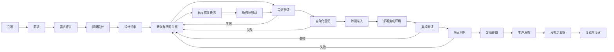

# Regent 研发交付全流程设计

| 项目 | 内容 |
|---|---|
| 文档状态 | 产品与技术方案，待评审 |
| 编写日期 | 2026-10-23 |
| 关联文档 | `ARCHITECTURE.md`、`集成测试环境与执行闭环.md`、`项目版本管理.md` |
| 设计目标 | 把立项、需求、设计、研发、测试、转测、集成、发版串成一条可执行、可追溯、可门禁的交付流水线 |
| 不做什么 | 不引入通用 BPMN 工作流引擎，不把现有任务、测试、部署能力推倒重做 |

## 一、结论先行

Regent 当前已经具备任务执行、需求拆解、自动化测试、变更审阅、Git 提交、部署和发布能力，但这些能力仍分散在不同页面，缺少一条统一的交付主线。

本设计在现有能力之前补齐三个阶段：

```text
立项
  → 需求
  → 需求评审
  → 详细设计
  → 设计评审
  → 研发
  → 冒烟测试
  → 自动化回归
  → 转测
  → 集成测试
  → 发版评审
  → 生产发布
  → 发布后观察与复盘
```

并增加一个贯穿全流程的**交付单/发布单**模型，让每次交付都能回答：

1. 为什么做这件事？
2. 谁批准了需求和设计？
3. 这是哪一个代码提交和构建制品？
4. 冒烟、自动化、集成测试分别跑了什么、结果是什么？
5. 当前卡在哪个门禁、卡住的原因是什么？
6. 修了哪些 Bug，修复后又重跑了哪些测试？
7. 最终发布到生产的是不是同一份制品？

## 二、设计原则

### 2.1 固定流程，不做通用工作流引擎

首版只支持固定的研发交付模板，不为每个项目开放任意拖拽节点。固定阶段更容易保证门禁、权限、审计和数据一致性。

首版提供两种模板：

| 模板 | 适用场景 | 保留阶段 |
|---|---|---|
| `STANDARD` | 新功能、新系统、多任务需求 | 立项、需求评审、设计评审、研发、冒烟、自动化、转测、集成、发版 |
| `FAST` | 小型修复、低风险配置变更 | 变更说明、研发、冒烟、定向自动化、发版；可复用项目级立项 |

无论使用哪个模板，都不能静默跳过门禁。跳过必须留下原因、批准人和风险说明。

### 2.2 一次构建，逐级晋级

测试环境、集成环境和生产环境部署的必须是同一个不可变制品。

```text
Git Commit
  → Build Artifact
  → TEST 环境
  → INTEGRATION 环境
  → PRODUCTION 环境
```

不允许在转测、集成或生产阶段重新构建不同制品。重新构建会产生新的制品和新的审批轮次。

### 2.3 自动采集证据，人工只做判断

平台自动采集：

- Git 提交、变更范围和构建日志；
- 测试计划、测试运行、失败项、证据文件；
- 部署记录、健康检查、日志；
- Bug、失败测试和修复任务之间的关联。

人工只负责需要业务判断的门禁：

- 立项批准；
- 需求评审；
- 设计评审；
- 转测准入；
- 发版批准；
- 风险例外。

### 2.4 证据快照不可回写

每次门禁通过时，保存当时的证据快照：

- 制品摘要和 Git 提交；
- 测试运行 ID 与结果摘要；
- 部署记录 ID；
- 审阅快照 ID；
- 未关闭 Bug 数量；
- 批准人和批准时间。

后续重新运行测试或修改设计，不会改变历史门禁结论；新证据会让旧门禁变为 `STALE`，需要重新判断。

### 2.5 业务状态和流程状态分离

现有 `Requirement.status`、`Task.status` 继续表达业务执行状态。

新增的 `RequirementDelivery.stage` 专门表达研发交付阶段。前端同时展示两层信息：

```text
需求状态：已完成 / 执行中 / 待确认
交付阶段：设计评审通过 / 冒烟测试中 / 待转测
```

不把“需求评审中”“设计评审中”塞进现有执行状态机，避免一个字段同时承担两种语义。

## 三、参与角色

角色属于项目，存储在 `project_member`，同一账号可以在不同项目承担不同角色。

| 角色 | 主要职责 |
|---|---|
| 项目负责人 | 立项、范围、资源、里程碑和最终风险 |
| 产品/需求负责人 | 需求说明、验收标准、需求评审 |
| 架构/技术负责人 | 详细设计、技术风险、设计评审 |
| 开发 | 任务实施、代码审阅、单元测试、自测 |
| 测试/QA | 测试计划、自动化回归、转测准入、集成测试 |
| 发布负责人 | 发版评审、生产发布、回滚决策 |
| AI 执行器 | 阅读资料、执行任务、补充证据、发现缺陷、汇报阻塞 |

门禁记录保存 `reviewer_id`、`role_code`、`decision` 和 `comment`；审批人姓名通过项目成员和账号资料关联展示，
避免改名后历史审计出现两份互相矛盾的人名。

如果当前部署只有一个账号，允许项目负责人代行审批，但必须在界面显示“代审”，不能伪装成独立评审。

### 3.1 门禁角色矩阵

| 门禁动作 | 必需角色 |
|---|---|
| 立项审批、关闭/取消交付、关闭发布 | 项目负责人 `OWNER` |
| 需求评审 | 产品负责人 `PRODUCT` |
| 提交设计、设计评审、研发完成 | 技术负责人 `TECH_LEAD` |
| 冒烟、自动化回归、转测、集成测试、版本回归 | 测试负责人 `QA` |
| 创建发布、发版评审、生产部署确认 | 发布负责人 `RELEASE_MANAGER` |

后端是权限判断的唯一事实源。前端只根据成员角色隐藏无权操作、提示当前等待的角色；
即使绕过界面直接调用 API，后端仍会拒绝不属于该角色的操作。

### 3.2 单人环境

当项目只有一个成员且该成员是项目负责人时，允许其代行所有门禁角色。
门禁意见自动追加“单人模式代审”，前端同时显示单人模式提示。
项目一旦增加第二名成员，该代审能力立即失效，必须显式分配产品、技术、测试和发布角色。

## 四、流程总览

### 4.1 两级流程

完整流程拆成两级，避免把需求评审和版本发布塞进同一个状态机：

```text
需求交付流 RequirementDelivery
  立项 → 需求 → 需求评审 → 详细设计 → 设计评审
  → 研发 → 冒烟 → 自动化回归 → 可以转测

版本发布流 Release
  纳入需求 → 转测 → 部署集成环境 → 集成测试
  → 版本回归 → 发版评审 → 生产发布 → 观察 → 关闭
```

一个 `Release` 可以包含一个或多个已具备转测条件的 `RequirementDelivery`。

一个需求同一时间只能进入一个未结束的 Release。

### 4.2 端到端图



### 4.3 关键阶段说明

| 阶段 | 负责人 | 输入 | 输出 | 进入下一阶段的条件 |
|---|---|---|---|---|
| 立项 | 项目负责人 | 业务目标、范围、资源、风险 | 立项单、审批记录 | 立项通过 |
| 需求 | 产品负责人 | 立项范围、用户目标 | 需求说明、验收标准 | 需求可进入评审 |
| 需求评审 | 产品/技术/测试 | 需求说明、影响分析 | 评审意见、评审结论 | 评审通过或明确修改项 |
| 详细设计 | 技术负责人 | 已评审需求、项目资料 | 设计规格、接口/数据/测试策略 | 设计可进入评审 |
| 设计评审 | 技术/测试/运维 | 设计规格、风险清单 | 设计评审结论 | 评审通过 |
| 研发 | 开发/Codex | 设计规格、任务 | 代码、单元测试、Git 提交 | 开发完成且代码审阅通过 |
| 冒烟测试 | 测试/Codex | 构建制品、测试环境 | 冒烟结果、证据 | 全部必跑冒烟通过 |
| 自动化回归 | 测试/Codex | 制品、自动化用例/测试计划 | 自动化报告 | 必跑用例通过且无阻塞 Bug |
| 转测 | 测试负责人 | 自动化报告、遗留问题、制品 | 转测审批 | 转测通过 |
| 集成测试 | 测试/Codex | 同一制品、集成环境 | 集成测试计划与结果 | 集成计划通过 |
| 版本回归 | 测试/Codex | 版本级测试计划 | 回归报告 | 回归通过 |
| 发版评审 | 发布负责人 | 集成/回归报告、风险、回滚方案 | 发版批准 | 发版通过 |
| 生产发布 | 发布负责人 | 同一制品、生产部署配置 | 部署记录、健康检查 | 生产冒烟通过 |
| 观察/关闭 | 项目负责人 | 监控、用户反馈 | 复盘、关闭记录 | 观察期结束 |

## 五、门禁设计

### 5.1 门禁类型

| 门禁 | 类型 | 作用 |
|---|---|---|
| G0 立项 | 人工 | 确认业务价值和资源投入 |
| G1 需求评审 | 人工 | 确认需求正确、完整、可验收 |
| G2 设计评审 | 人工 | 确认技术方案、测试方案、回滚方案 |
| G3 冒烟 | 自动为主 | 确认制品在测试环境基本可用 |
| G4 自动化回归 | 自动 | 确认需求影响范围没有回归 |
| G5 转测 | 人工 | 确认测试报告、遗留风险和交付边界 |
| G6 集成测试 | 自动/人工混合 | 确认跨模块、接口、环境和靶机协同 |
| G7 版本回归 | 自动 | 确认版本级回归通过 |
| G8 发版评审 | 人工 | 确认生产风险、回滚和发布窗口 |
| G9 生产发布 | 自动执行 + 人工批准 | 发布同一制品并做生产冒烟 |
| G10 关闭 | 人工 | 确认观察期、复盘和遗留问题 |

### 5.2 门禁状态

```text
PENDING    等待执行或等待审批
PASSED     条件满足
REJECTED   人工拒绝，需要返工
BLOCKED    缺少环境、权限、资料或工具
WAIVED     有审批记录的例外放行
STALE      证据已过期，需要重新判断
```

`WAIVED` 不能是默认能力。必须有：

- 豁免原因；
- 风险说明；
- 批准人；
- 有效期或适用制品；
- 后续补偿动作。

### 5.3 证据和失效规则

每个门禁保存 `evidence_snapshot`，至少包含：

```json
{
  "artifactId": 12,
  "commitSha": "a1b2c3",
  "requirementVersion": 3,
  "designVersion": 2,
  "testPlanRunIds": [41, 42],
  "deploymentRunIds": [88],
  "reviewSnapshotIds": [71],
  "openBlockerBugCount": 0,
  "capturedAt": "2026-10-23T10:00:00Z"
}
```

失效规则：

- Git 提交变化 → 重新构建，所有依赖该提交的验证证据失效；
- 测试计划版本变化 → 对应测试门禁失效；
- 设计版本变化 → 设计评审及其后的研发门禁失效；
- 新增阻塞 Bug → 当前和后续发布门禁失效；
- 部署到不同环境 → 只认可该环境对应的测试证据；
- 同一份证据只能支持它覆盖的制品和环境。

### 5.4 门禁判定服务

门禁判定放在 `delivery` 应用服务中，不把判断散落在前端：

```text
GateEvaluator.evaluate(gate, now)
  1. 检查前置阶段是否完成
  2. 检查证据是否存在且未过期
  3. 检查测试计划是否满足 gatePolicy
  4. 检查阻塞 Bug 数量
  5. 检查人工审批是否齐备
  6. 返回 PASSED / BLOCKED / REJECTED / STALE
```

前端只展示结果和下一步可执行动作，不自行推断“应该可以通过”。

## 六、Bug 与返工闭环

### 6.1 Bug 来源

- 冒烟测试失败；
- 自动化回归失败；
- 集成测试失败；
- 版本回归失败；
- 生产发布后冒烟失败；
- 人工测试或用户反馈。

### 6.2 Bug 关联字段

Bug 至少关联：

- 项目；
- 需求交付单；
- 失败测试运行或测试项；
- 构建制品；
- 发布单；
- 修复任务；
- 重新验证的测试运行。

### 6.3 返工循环

```text
测试失败
  → 创建或更新 Bug
  → 评估是否阻塞转测/发版
  → 创建修复任务
  → 修复代码
  → 新 Git 提交
  → 新构建制品
  → 重跑失败测试
  → 重跑受影响回归
  → 重新进入转测/集成/发版门禁
```

旧制品和旧测试记录永远保留，不覆盖。新构建产生新的发布轮次。

### 6.4 阻塞规则

- `BLOCKER` Bug 未关闭 → 转测和发版门禁必须阻止；
- `CRITICAL` Bug 默认阻止，必须有豁免审批；
- `MAJOR` Bug 可由发布负责人按风险决定；
- 失败测试没有解释和关联 Bug → 不允许标为已处理。

## 七、领域模型

### 7.1 新增上下文

新增 `delivery` 限界上下文，承载过程编排和交付门禁。

它不替代 `requirement`、`testing`、`deployment`、`bug`、`review`，只通过 ID 引用这些上下文的聚合。

### 7.2 聚合

| 聚合 | 说明 |
|---|---|
| `Initiative` | 立项单：目标、范围、资源、里程碑、风险和批准结论 |
| `RequirementDelivery` | 需求交付单：立项后的一条需求交付过程 |
| `DesignSpec` | 详细设计规格及版本 |
| `StageGate` | 阶段门禁及审批轮次 |
| `BuildArtifact` | 不可变构建制品 |
| `Release` | 一次版本发布轮次，绑定一个制品和一组需求交付单 |

### 7.3 实体和值对象

```text
InitiativeId / RequirementDeliveryId / DesignSpecId
StageGateId / BuildArtifactId / ReleaseId
CommitSha / ArtifactDigest / VersionLabel
GateType / GateStatus / DeliveryStage
ReviewDecision / DeliveryTemplate / EnvironmentRole
```

### 7.4 `Initiative`

```text
Initiative
  - id
  - projectId
  - title
  - businessGoal
  - scope
  - outOfScope
  - successMetrics
  - milestones
  - risks
  - ownerId
  - status: DRAFT / SUBMITTED / APPROVED / REJECTED / CANCELLED
  - submittedAt
  - approvedAt
```

状态迁移：

```text
DRAFT → SUBMITTED → APPROVED
                 └→ REJECTED → DRAFT
```

约束：

- 项目必须属于当前账号；
- 立项未通过，不能创建正式需求交付单；
- 已通过立项的范围、目标和成功指标只能追加变更记录，不能静默覆盖。

### 7.5 `RequirementDelivery`

```text
RequirementDelivery
  - id
  - initiativeId
  - requirementId
  - projectId
  - template: STANDARD / FAST
  - stage
  - status: ACTIVE / BLOCKED / COMPLETED / CANCELLED
  - currentGateId
  - createdAt
```

阶段：

```text
REQUIREMENT_DRAFT
REQUIREMENT_REVIEW
DESIGN
DESIGN_REVIEW
DEVELOPMENT
SMOKE
AUTOMATION_REGRESSION
READY_FOR_TRANSFER
IN_RELEASE
RELEASED
CLOSED
```

约束：

- 一个需求最多有一个未结束的交付单；
- 需求评审通过前不能提交设计；
- 设计评审通过前不能派发实现任务；
- `READY_FOR_TRANSFER` 必须存在自动化回归证据；
- 进入 `IN_RELEASE` 后需求范围不能静默扩大。

### 7.6 `DesignSpec`

```text
DesignSpec
  - id
  - requirementDeliveryId
  - requirementId
  - version
  - summary
  - architecture
  - moduleChanges
  - apiChanges
  - dataChanges
  - permissionChanges
  - nonFunctionalRequirements
  - testStrategy
  - migrationPlan
  - rollbackPlan
  - attachmentIds
  - status: DRAFT / SUBMITTED / APPROVED / REJECTED
```

设计文档必须明确：

- 影响哪些模块和服务；
- 是否有数据库迁移；
- 是否需要新增接口或修改契约；
- 权限、安全、性能和兼容性风险；
- 如何测试；
- 失败如何回滚。

### 7.7 `BuildArtifact`

```text
BuildArtifact
  - id
  - projectId
  - version
  - gitCommit
  - gitTag
  - digest
  - sizeBytes
  - storageRef
  - buildLogRef
  - status: SUCCESS / FAILED
  - builtAt
  - builtBy
```

约束：

- 制品内容不可变；
- `digest` 是制品身份的一部分；
- 同一制品可以部署到多个环境，但不能在不同环境重新构建；
- 没有制品摘要的部署记录不能进入发版门禁。

### 7.8 `Release`

```text
Release
  - id
  - projectId
  - version
  - attemptNo
  - buildArtifactId
  - status
  - stage
  - previousReleaseId
  - releaseNotes
  - rollbackPlan
  - createdAt
```

阶段：

```text
TRANSFER
INTEGRATION
REGRESSION
RELEASE_REVIEW
PRODUCTION
OBSERVING
CLOSED
```

同一个版本修复后重新转测时，不覆盖旧 `Release`，而是创建新的 `attemptNo`，旧记录标记为 `SUPERSEDED`。

`release_item` 保存本次发布包含的 `requirementDeliveryId`。

### 7.9 `StageGate`

```text
StageGate
  - id
  - scopeType: INITIATIVE / REQUIREMENT_DELIVERY / RELEASE
  - scopeId
  - gateType
  - round
  - status
  - decision
  - comment
  - evidenceSnapshot
  - decidedBy
  - decidedAt
```

同一阶段可以有多轮审批。历史轮次不删除。

## 八、跨上下文关系

### 8.1 与现有上下文

| 上下文 | 关系 |
|---|---|
| `project` | 项目是租户根；立项单、交付单和发布单都必须校验项目归属 |
| `requirement` | `RequirementDelivery` 持有 `RequirementId`；需求状态和交付阶段分开 |
| `execution` | 研发实现仍走任务、任务运行和设备代理；任务完成后回写交付阶段 |
| `review` | 现有变更审阅快照作为研发门禁证据 |
| `testing` | 现有自动化测试用例作为自动化回归证据；新增产品测试计划承载冒烟和集成测试 |
| `deployment` | 部署记录增加发布单、制品和环境角色；同一制品逐级晋级 |
| `bug` | Bug 关联需求、测试运行、制品和发布单，形成返工闭环 |
| `gitcommit` | Git 提交记录作为制品和审阅的代码事实 |
| `notification` | 门禁待审批、阻塞、失败和发版通知 |

### 8.2 与现有 `governance` 的区别

`governance` 负责 AI 执行中的 L0–L3 决策分级，解决“某一步 AI 能不能自主决定”。

`delivery` 负责研发阶段门禁，解决“这件事能不能进入下一阶段”。

两者不能合并：

- AI 可以自主完成代码，不代表可以跳过设计评审；
- 人类批准了设计，不代表某个高风险部署操作不需要决策分级；
- 两者的审计对象、责任人和状态机都不同。

### 8.3 应用层编排

关键跨上下文动作由应用服务显式编排：

```text
InitiativeApprovalService
  - 保存立项审批
  - 创建/激活需求交付前置条件

RequirementDeliveryService
  - 启动交付流
  - 触发需求评审
  - 审批设计
  - 汇总研发完成条件

ReleaseService
  - 纳入交付单
  - 绑定制品
  - 推进转测、集成、发版
  - 触发部署

GateEvaluationService
  - 计算门禁
  - 固化证据快照
  - 处理过期和返工
```

跨聚合只保存 ID，不持有其他上下文聚合根。

## 九、数据模型

具体迁移版本按实际最新 Flyway 版本递增。当前代码库最新迁移为 `V50`，实现时不能覆盖历史脚本。

### 9.1 新增表

#### `initiative`

| 字段 | 说明 |
|---|---|
| `id` | 主键 |
| `project_id` | 项目 ID |
| `title` | 立项名称 |
| `business_goal` | 业务目标 |
| `scope_text` | 范围 |
| `out_of_scope_text` | 非目标 |
| `success_metrics` | 成功指标 |
| `owner_id` | 负责人 |
| `status` | DRAFT / SUBMITTED / APPROVED / REJECTED / CANCELLED |
| `submitted_at` / `approved_at` | 时间 |
| `created_at` / `updated_at` | 审计时间 |

#### `requirement_delivery`

| 字段 | 说明 |
|---|---|
| `id` | 主键 |
| `initiative_id` | 立项单 ID |
| `requirement_id` | 需求 ID |
| `project_id` | 项目 ID |
| `template` | STANDARD / FAST |
| `stage` | 当前交付阶段 |
| `status` | ACTIVE / BLOCKED / COMPLETED / CANCELLED |
| `current_gate_id` | 当前门禁 |
| `created_at` / `updated_at` | 时间 |

唯一约束：一个 `requirement_id` 只能有一个未结束的交付单。

#### `design_spec`

| 字段 | 说明 |
|---|---|
| `id` | 主键 |
| `requirement_delivery_id` | 交付单 |
| `requirement_id` | 需求 |
| `version` | 设计版本 |
| `content` | 设计正文 |
| `status` | DRAFT / SUBMITTED / APPROVED / REJECTED |
| `created_by` / `created_at` | 创建 |
| `reviewed_by` / `reviewed_at` | 审批 |

结构化字段可以用独立列保存，附件使用现有文件存储，数据库只存引用和摘要。

#### `build_artifact`

| 字段 | 说明 |
|---|---|
| `id` | 主键 |
| `project_id` | 项目 |
| `version` | 版本 |
| `git_commit` | 提交 SHA |
| `git_tag` | 可选 Tag |
| `digest` | SHA-256 |
| `size_bytes` | 大小 |
| `storage_ref` / `log_ref` | 制品与构建日志引用 |
| `status` | SUCCESS / FAILED |
| `built_at` / `built_by` | 构建事实 |

#### `release`

| 字段 | 说明 |
|---|---|
| `id` | 主键 |
| `project_id` | 项目 |
| `version` | 版本 |
| `attempt_no` | 第几次发布轮次 |
| `build_artifact_id` | 绑定制品 |
| `stage` | 当前发布阶段 |
| `status` | ACTIVE / SUPERSEDED / RELEASED / FAILED / CANCELLED |
| `previous_release_id` | 上一轮次 |
| `release_notes` / `rollback_plan` | 发布与回滚说明 |

#### `release_item`

| 字段 | 说明 |
|---|---|
| `release_id` | 发布单 |
| `requirement_delivery_id` | 纳入本次发布的需求交付单 |
| `created_at` | 纳入时间 |

#### `stage_gate`

| 字段 | 说明 |
|---|---|
| `id` | 主键 |
| `scope_type` | INITIATIVE / REQUIREMENT_DELIVERY / RELEASE |
| `scope_id` | 对应对象 ID |
| `gate_type` | 门禁类型 |
| `round` | 审批轮次 |
| `status` | PENDING / PASSED / REJECTED / BLOCKED / WAIVED / STALE |
| `decision` | 人工结论 |
| `comment` | 审批意见 |
| `evidence_snapshot` | 不可变证据快照 |
| `decided_by` / `decided_at` | 审批人 |

#### `stage_gate_item`

用于保存评审检查项，不把关键门禁逻辑塞进不可查询的 JSON：

| 字段 | 说明 |
|---|---|
| `gate_id` | 门禁 |
| `item_key` | 检查项 |
| `required` | 是否必过 |
| `passed` | 是否通过 |
| `comment` | 说明 |

#### `gate_evidence`

| 字段 | 说明 |
|---|---|
| `gate_id` | 门禁 |
| `evidence_type` | TEST_PLAN_RUN / AUTOMATION_RUN / DEPLOYMENT_RUN / REVIEW_SNAPSHOT / BUILD_LOG / DESIGN_VERSION |
| `source_id` | 来源 ID |
| `digest` | 快照摘要 |
| `captured_at` | 采集时间 |

#### `bug_delivery_link`

| 字段 | 说明 |
|---|---|
| `bug_id` | Bug |
| `requirement_delivery_id` | 需求交付单 |
| `release_id` | 发布单 |
| `test_run_id` | 失败测试 |
| `build_artifact_id` | 发现问题的制品 |
| `blocking` | 是否阻塞 |

### 9.2 现有表扩展

`deployment_run` 增加：

- `release_id`；
- `build_artifact_id`；
- `environment_role`（`TEST` / `INTEGRATION` / `PRODUCTION`）。

`requirement` 新增：

- `initiative_id`（可空，历史需求允许为空）。

`bug` 通过 `bug_delivery_link` 关联流程，不把多个流程字段硬塞进 Bug 主表。

### 9.3 历史数据兼容

- 已有需求不强制补立项，显示“历史需求，未走立项流程”；
- 已有任务和部署继续可用；
- 已有部署没有制品 ID 时显示“未登记制品”，但不能通过新的发版门禁；
- 新项目和新需求默认走标准流程；
- 迁移只追加列和表，不重写历史状态。

## 十、接口设计

### 10.1 立项

```text
POST   /api/initiatives
GET    /api/initiatives
GET    /api/initiatives/{id}
PUT    /api/initiatives/{id}
POST   /api/initiatives/{id}/submit
POST   /api/initiatives/{id}/approve
POST   /api/initiatives/{id}/reject
```

### 10.2 需求交付

```text
POST   /api/initiatives/{id}/requirement-deliveries
GET    /api/requirement-deliveries/{id}
GET    /api/projects/{projectId}/delivery-overview
POST   /api/requirement-deliveries/{id}/submit-review
POST   /api/requirement-deliveries/{id}/design
POST   /api/requirement-deliveries/{id}/design/submit
POST   /api/requirement-deliveries/{id}/gates/{gateType}/approve
POST   /api/requirement-deliveries/{id}/gates/{gateType}/reject
```

### 10.3 构建和发布

```text
POST   /api/builds
GET    /api/builds/{id}
POST   /api/releases
GET    /api/releases/{id}
POST   /api/releases/{id}/transfer
POST   /api/releases/{id}/integration
POST   /api/releases/{id}/regression
POST   /api/releases/{id}/release-review
POST   /api/releases/{id}/deploy
POST   /api/releases/{id}/observe
POST   /api/releases/{id}/close
```

### 10.4 门禁和证据

```text
GET    /api/stage-gates/{id}
POST   /api/stage-gates/{id}/approve
POST   /api/stage-gates/{id}/reject
POST   /api/stage-gates/{id}/waive
GET    /api/delivery/blockers
```

### 10.5 统一返回

门禁详情返回必须包含：

```json
{
  "gateType": "TRANSFER",
  "status": "BLOCKED",
  "requirements": [
    { "id": 12, "title": "支持多项目环境", "stage": "READY_FOR_TRANSFER" }
  ],
  "checks": [
    {
      "key": "automation-report",
      "label": "自动化回归报告",
      "required": true,
      "passed": false,
      "reason": "存在 2 个失败用例"
    }
  ],
  "evidence": [],
  "nextActions": ["查看失败用例", "创建 Bug", "重新构建"]
}
```

前端直接按 `checks` 展示阻塞原因，不自行拼业务判断。

## 十一、界面设计

### 11.1 导航

不新增一级菜单，保持工作台、任务、交付、项目四项。

- `项目` 工作区增加“研发流程”：立项、需求交付、设计。
- `交付` 工作区增加“发布流程”：转测、集成、回归、发版。
- `任务` 仍是执行工作区，任务详情显示所属需求和发布阶段。
- `工作台` 增加“研发流水线”视图，展示所有阻塞和待审批门禁。

### 11.2 需求详情

需求详情增加阶段条：

```text
需求评审 → 详细设计 → 设计评审 → 研发 → 冒烟 → 自动化 → 转测
```

每个阶段展示：

- 当前状态；
- 负责人；
- 最近一次结果；
- 门禁阻塞项；
- 相关任务、测试、部署和证据。

### 11.3 发布详情

发布详情使用阶段条：

```text
转测 → 集成环境 → 集成测试 → 版本回归 → 发版评审 → 生产发布 → 观察
```

右侧显示：

- 制品版本、Git 提交、摘要；
- 包含的需求；
- 未关闭 Bug；
- 当前阶段的测试报告；
- 下一步允许的操作。

### 11.4 工作台

新增“研发流水线”区域：

- 待立项审批；
- 待需求评审；
- 待设计评审；
- 转测阻塞；
- 集成失败；
- 待发版审批；
- 发布后异常。

执行控制塔继续展示任务和部署执行；研发流水线展示交付阶段，两者互相跳转。

### 11.5 快速通道

项目设置中允许启用 `FAST` 模板。快速通道仍必须：

- 关联一个已批准的项目级立项；
- 填写变更说明和影响范围；
- 至少执行冒烟和定向自动化；
- 发版前有人工批准；
- 出现问题必须进入 Bug 返工。

快速不代表无记录。

## 十二、构建与部署

### 12.1 构建端口

```java
public interface BuildProvider {
    BuildResult build(BuildRequest request);
}
```

首版支持：

- `LOCAL_COMMAND`：项目配置的构建命令；
- `EXTERNAL_CI`：由 CI 回调登记构建结果。

平台负责保存构建事实和制品摘要，不假设所有项目都使用同一种 CI。

### 12.2 环境角色

每个部署配置必须声明环境角色：

- `TEST`：冒烟和自动化；
- `INTEGRATION`：集成测试；
- `PRODUCTION`：生产。

同一制品可以部署到多个环境，但每个环境有独立部署记录和测试证据。

### 12.3 发布约束

- 生产部署必须绑定 `release_id` 和 `build_artifact_id`；
- 生产部署前检查 `RELEASE_REVIEW` 门禁；
- 发布后执行生产冒烟；
- 生产冒烟失败时保留现场，不自动重复发布；
- 回滚使用上一份已登记制品，不能临时重新构建。

## 十三、权限、安全和审计

### 13.1 权限

所有对象通过 `project.owner_id` 做租户隔离。

门禁审批校验：

- 当前用户属于项目；
- 当前用户具备对应角色；
- 不能重复审批同一轮次；
- 不能审批自己创建且制度要求独立评审的文档。

### 13.2 安全

- 制品校验 SHA-256；
- 测试脚本和设计附件限制大小和类型；
- 凭据只存引用，不进入门禁快照；
- 日志、截图和测试证据上传前做敏感信息扫描；
- 发布操作需要幂等键，防止重复点击造成重复部署。

### 13.3 审计

每次状态变更记录：

- 操作人；
- 操作时间；
- 变更前阶段；
- 变更后阶段；
- 关联门禁；
- 证据摘要；
- 失败原因或豁免理由。

历史门禁和证据不能物理删除。

## 十四、MVP 拆分

### 阶段 1：流程底座

- `Initiative`；
- `RequirementDelivery`；
- `DesignSpec`；
- `StageGate`；
- `BuildArtifact`；
- `Release`；
- 基本门禁规则；
- 项目、需求、发布详情页；
- 工作台待审批和阻塞汇总；
- 历史数据兼容。

此阶段先支持手工登记构建制品，不要求平台自动执行所有构建。

### 阶段 2：测试与部署闭环

- 现有自动化测试用例接入需求回归门禁；
- 测试计划、测试报告、失败项和证据接入；
- `deployment_run` 绑定制品和发布单；
- 测试环境、集成环境、生产环境角色；
- Bug 关联失败测试和发布单；
- 发布后冒烟。

### 阶段 3：产品测试计划与环境画像

按 `集成测试环境与执行闭环.md` 实现：

- `ProductTestPlan`；
- `ProductTestSuite`；
- 冒烟、集成、回归、验收测试计划；
- 本地 Codex 分析和执行；
- 测试环境画像、靶机、租约和证据；
- 逐条测试结果与报告。

### 阶段 4：角色、指标和例外

- 角色权限和独立评审；
- 门禁豁免与到期；
- 阶段停留时长；
- 转测通过率；
- 自动化通过率；
- 发布失败率、回滚率、MTTR；
- 发布模板和项目级策略；
- 灰度、金丝雀和自动回滚。

## 十五、验收场景

### 场景 1：标准需求全流程

```text
Given 立项已批准
When 创建需求并通过需求评审、设计评审
Then 才能创建研发任务
And 冒烟和自动化通过后才能提交转测
And 集成和版本回归通过后才能发版
```

### 场景 2：自动化失败

```text
Given 自动化回归存在失败用例
When 用户尝试转测
Then 转测门禁阻塞
And 显示失败用例、制品和创建 Bug 入口
```

### 场景 3：Bug 返工

```text
Given 集成测试发现阻塞 Bug
When 修复完成并生成新制品
Then 旧发布轮次保留
And 新轮次重新执行失败测试和受影响回归
And 重新经过转测、集成和发版门禁
```

### 场景 4：证据失效

```text
Given 设计评审已通过
When 设计版本被修改
Then 设计评审变为 STALE
And 后续研发和发布门禁不能继续使用旧证据
```

### 场景 5：多需求发布

```text
Given 三个需求都达到 READY_FOR_TRANSFER
When 创建版本发布单
Then 三个需求进入同一个 Release
And 发布单展示每个需求的测试覆盖和未关闭 Bug
```

### 场景 6：快速通道

```text
Given 已存在项目级立项
When 使用 FAST 模板提交小型修复
Then 可以跳过详细设计评审
But 必须记录变更说明、冒烟结果、定向自动化结果和发版批准
```

## 十六、与现有实现的关系

本设计不要求一次性重写现有系统。

优先级最高的复用：

1. 任务、任务运行、设备代理继续作为研发执行层；
2. `review` 变更审阅继续作为研发质量门禁；
3. `testing` 自动化用例继续作为自动化回归；
4. `deployment` 部署执行继续作为环境部署器；
5. `bug` 继续作为缺陷事实；
6. `项目版本管理` 继续作为版本解析来源；
7. 现有执行控制塔增加交付阶段和门禁阻塞视角。

新增的 `delivery` 上下文只负责回答“这条交付走到哪、下一步能不能走”，不重复实现执行能力。

## 十七、必须补的测试

### 17.1 领域单测

- 立项状态机；
- 需求交付阶段守卫；
- 设计评审版本失效；
- 发布门禁前后置条件；
- Bug 阻塞规则；
- 证据快照过期规则。

### 17.2 应用集成测试

- 立项 → 需求 → 设计 → 研发 → 冒烟的完整链路；
- 自动化失败后转测阻塞；
- 集成失败后新制品重新进入流程；
- 同一制品逐级部署；
- 多需求发布；
- 历史数据兼容。

### 17.3 权限和安全测试

- 跨账号看不到项目、门禁、制品和发布；
- 非审批角色不能审批；
- 同一轮次重复审批幂等；
- 制品摘要不一致时阻止部署；
- 凭据不进入日志、证据和 API 响应。

## 十八、不做的事

- 不做任意节点拖拽的 BPMN 设计器；
- 不把需求、任务、测试、部署合并成一个巨型聚合；
- 不因为增加门禁而要求所有小改动都走完整审批；
- 不允许前端自行判断门禁是否通过；
- 不允许重新构建后复用旧环境的测试结论；
- 不把测试结果、Bug 和发布记录写成不可查询的自然语言日志。

## 十九、落地顺序建议

1. 先落 `Initiative`、`RequirementDelivery`、`DesignSpec`、`StageGate`。
2. 把现有任务创建接到设计评审门禁后面，同时保留快速通道。
3. 增加 `BuildArtifact` 和发布单，先支持手工登记制品。
4. 接现有自动化测试，形成冒烟和需求回归门禁。
5. 接现有部署记录，实现同一制品从测试到集成到生产。
6. 接 Bug 返工关联和证据失效。
7. 最后实现产品测试计划、环境画像、角色权限和指标。

这样每一步都能独立上线，不会出现“流程画出来了但没有任何一步可执行”的情况。
