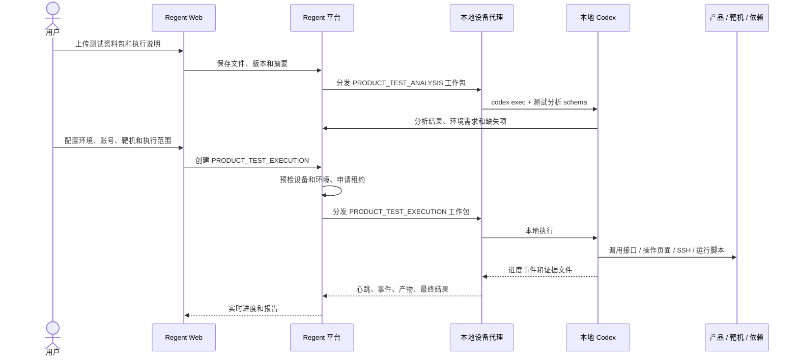

# 通用测试资料包与本地 Codex 执行闭环设计

| 项目 | 内容 |
|---|---|
| 文档状态 | 产品设计，待评审 |
| 编写日期 | 2026-10-23 |
| 输入样本 | `V3.0.2_R100集成测试用例.CSV` |
| 执行方式 | 本机设备代理调用本地 Codex 读取测试资料并执行 |
| 设计重点 | 异构测试资料、本机执行、环境依赖、进度、证据和结果契约 |

## 一、设计修正

测试用例不会永远采用同一种格式，平台不能围绕某一份 CSV 的列结构设计。

实际资料可能是：

- CSV、Excel 测试用例表；
- Markdown、Word、PDF 测试方案；
- Postman Collection、OpenAPI、JSON 数据；
- Pytest、Playwright、Shell 等项目测试脚本；
- 图片、录屏、日志、抓包和接口响应；
- 人工检查清单或自然语言验收要求。

执行也不应该由平台为每条用例预先绑定命令，而应由**本地 Codex**读取测试资料，理解测试目标，使用用户电脑上的代码、浏览器、命令行、网络和靶机资源执行测试，最后返回结构化结果。

因此职责划分应为：

```text
平台：保存资料、选择设备、准备环境和权限、分发工作包、展示进度、归档证据、审计结果
本地设备代理：下载资料、启动 Codex、上传事件和产物、续租
本地 Codex：理解不同格式、制定执行计划、运行测试、检查结果、返回结论
测试环境：提供被测产品、靶机、账号、数据、工具和依赖
```

平台不是测试执行器本身，也不应强迫所有资料统一成同一种“用例模型”。

### 1.1 自动化测试与需求测试不是同一类对象

当前系统中的“测试用例”实际是**自动化测试用例**：一条命令或脚本，在项目目录或测试设备上执行，根据退出码、断言或输出判断结果。

产品需求要执行的冒烟测试、集成测试则是**需求级测试计划**：为了验证某个需求或版本是否可交付，需要使用一组异构测试资料、产品环境、靶机、账号和测试数据，由本地 Codex 理解并执行。

两者的边界：

| 维度 | 自动化测试用例 | 产品需求测试 |
|---|---|---|
| 当前系统对应 | 已有 `TestCase` / `TestCaseRun` | 本次新增能力 |
| 核心对象 | 一条可重复执行的命令或脚本 | 绑定需求、版本和环境的测试计划 |
| 测试资料 | 脚本、命令、接口样例 | CSV、Excel、文档、脚本、截图等异构资料包 |
| 执行粒度 | 单条自动化检查 | 一次冒烟、集成、回归或验收测试 |
| 执行者 | 平台测试执行器或本地设备 | 本地 Codex + 设备代理 |
| 结果 | 退出码、断言、摘要、输出 | 动态测试项结果、进度、证据和阻塞项 |
| 主要用途 | 开发验证、任务完成后自动检查、回归脚本 | 需求验收、版本交付、上线门槛 |
| 与需求关系 | 可以被测试计划引用，但不天然属于某个需求 | 需求级计划绑定需求；版本级计划绑定目标版本 |

推荐的产品关系：

```text
ProductRequirement
  ├─ Task 1..N
  ├─ ProductTestPlan: 冒烟测试
  │    ├─ ProductTestSuite
  │    └─ AutomationTestCaseRef 1..N
  ├─ ProductTestPlan: 集成测试
  │    ├─ ProductTestSuite
  │    └─ AutomationTestCaseRef 1..N
  └─ ProductTestRun 1..N

ProjectVersion
  └─ ProductTestPlan: 版本集成 / 回归测试

AutomationTestCase
  └─ AutomationTestCaseRun 1..N
```

冒烟测试和集成测试不应继续塞进现有 `test_case` 表。它们需要独立的测试计划、测试包、运行和结果模型。

产品界面也应明确：

- 当前“测试”入口改名为“自动化测试”；
- 在产品需求详情中增加“冒烟测试”和“集成测试”；
- 测试计划中可以引用自动化测试用例；
- 自动化测试通过不等于需求级测试通过；
- 需求级测试通过必须基于本次计划和环境的事实。

## 二、对当前样本的判断

这份 CSV 可以在具备环境和执行能力时交给本地 Codex 执行，但不能脱离环境直接得到可信结果。

样本本身的情况：

| 指标 | 结果 |
|---|---:|
| 编码 | GB18030 / GBK |
| 记录数 | 202 条，19 个模块 |
| 明确标记“可自动化UI功能测试” | 14 条 |
| 明确标记“可自动化功能测试” | 23 条 |
| 自动化提示合计 | 37 条 |
| 未标记为可自动化的用例 | 165 条 |
| 适用阶段 | 0 条有值 |

这些数字只描述当前文件，不能成为平台导入的固定结构。CSV 中的“可自动化”也只是人工提示，不代表已经存在可执行脚本。

从文件名和内容角度看，这份资料更适合作为**项目版本级集成测试包**，供 `V3.0.2_R100` 的版本测试计划引用；其中与某个具体需求相关的部分，也可以由需求级冒烟或集成计划再次引用。资料包与测试计划是多对多关系，不要求一份文件只服务一个需求。

本地 Codex 可以读取这份表，逐条理解前置条件、步骤和预期，再选择：

- 直接调用产品接口验证；
- 使用 Playwright 等工具操作页面；
- 通过 SSH 或命令检查靶机；
- 执行已有自动化脚本；
- 对无法机器判定的视觉和语义结果给出“无结论”或转人工确认。

但前提是用户电脑已经具备相应工具，并且 Codex 能访问产品、靶机和测试账号。没有这些条件时，正确结果应是 `BLOCKED`，不是 `FAILED`，更不是 `PASSED`。

## 三、产品需求测试模型

### 3.1 需求测试计划

`ProductTestPlan` 绑定一个产品需求或一个项目版本，表达“这次交付前要执行什么测试”。

```text
ProductTestPlan
  - scopeType: REQUIREMENT / PROJECT_VERSION / RELEASE
  - scopeId
  - planType: SMOKE / INTEGRATION / REGRESSION / ACCEPTANCE
  - targetVersion
  - testSuiteIds
  - automationTestCaseIds
  - environmentProfileId
  - gatePolicy
  - status
```

需求级计划用于验证某个产品需求；版本级计划用于复用产品级集成、回归和发布测试包。一份产品测试资料包可以被多个计划引用，但每次执行都必须保存计划版本和环境快照。

关键不变量：

- `REQUIREMENT` 计划必须有需求 ID，且需求所属项目必须与计划一致；
- `PROJECT_VERSION` / `RELEASE` 计划必须有目标版本；
- 已有运行记录的计划不能修改已执行版本的历史快照；
- 计划引用的自动化测试用例必须与计划属于同一项目；
- 一个计划至少包含一个产品测试包或一条自动化测试用例。

计划类型：

| 类型 | 目标 | 典型触发时机 |
|---|---|---|
| `SMOKE` | 用最少的关键检查确认产品基本可用，发现问题立即停止 | 部署完成、进入完整测试前 |
| `INTEGRATION` | 验证需求涉及的模块、产品、靶机、模型服务、网关和数据能够协同工作 | 冒烟通过后、验收前 |
| `REGRESSION` | 验证需求改动没有破坏既有功能 | 集成通过后、发布前 |
| `ACCEPTANCE` | 按需求验收标准确认最终交付结果 | 集成和回归完成后 |

冒烟测试和集成测试是测试计划，不是两条自动化脚本。一个计划可以包含产品测试资料包，也可以引用现有自动化测试用例，但最终结论按整个计划聚合。

### 3.2 测试计划与交付门槛

测试计划结果与需求、版本和部署的关系：

```text
需求实现任务完成
  → 部署测试版本
  → 执行需求冒烟测试
  → 冒烟通过后执行需求集成测试
  → 需求验收

项目版本构建
  → 部署到测试环境
  → 执行版本集成测试
  → 执行版本回归测试
  → 允许发布或继续告警
```

门槛策略可配置：

- `NONE`：只展示结果；
- `WARN`：失败时提醒，但不阻止后续动作；
- `REQUIRED`：计划未通过时阻止需求验收、部署或发布。

自动化测试用例通过只能作为证据，不能直接把需求冒烟测试或集成测试标为通过。需求测试计划的结论由本次计划的全部测试项聚合。

### 3.3 产品测试资料包

需求测试计划引用一个或多个可执行的**产品测试资料包**。

```text
ProductTestSuite
  - 名称
  - 项目
  - 版本
  - 入口文件或入口说明
  - 执行说明
  - 文件清单
  - 环境画像
  - 执行范围
```

资料包包含任意数量的异构文件，平台保存原文件、目录结构和 SHA-256。原始资料是事实源，解析出的“用例清单”只是辅助索引。

用户上传时可以是：

- 单个文件；
- 多文件；
- 保留目录结构的 ZIP；
- 项目中的一个测试目录；
- 从 Git 仓库读取的某个提交。

### 3.4 不再强制统一用例格式

MVP 不要求每个测试文件都拆成统一字段：

```text
module / precondition / step / expected / priority
```

这些字段只在解析得到时作为可选元数据保存。无法解析的文件仍然可以进入测试包，由 Codex 直接阅读。

平台可提供解析适配器：

| 文件类型 | 平台可做的辅助处理 | 是否要求解析成功 |
|---|---|---|
| CSV / XLSX | 预览表格、识别行数、提供筛选 | 否 |
| Markdown / TXT / PDF / DOCX | 提取文本、页数、标题 | 否 |
| JSON / Postman / OpenAPI | 识别接口和请求 | 否 |
| 脚本 | 计算摘要、识别语言和入口 | 否 |
| 图片 / 视频 | 保存为测试素材或证据 | 否 |

解析失败不应导致整个测试包无法执行。真正的执行动作由本地 Codex 决定。

### 3.5 可选用例索引

Codex 在分析阶段可以生成建议索引：

```text
sourceRef: V3.0.2_R100集成测试用例.CSV#row=101
name: 【风险告警】Tab名称展示-安全事件
priorityHint: 高
automationHint: HIGH
requiredCapabilities: PRODUCT_UI, ACCOUNT, TEST_DATA
```

索引用于筛选、展示和分批执行，不要求执行前已经完整准确。执行结束后，以 Codex 返回的实际 `caseResults` 为准。

### 3.6 执行范围可以是自然语言

用户不必先把 202 条用例全部登记成数据库记录。发起执行时可以填写：

```text
执行这份 CSV 中所有“高”和 P0 用例，先做安全监测模块。
```

也可以：

- 选择 Codex 分析出的部分用例；
- 指定文件、章节、Sheet 或行范围；
- 选择已登记用例；
- 只执行最新失败项。

Codex 负责把范围转换成实际执行计划，并把每个结果的 `sourceRef` 回传到平台。

## 四、两阶段执行：先分析，再执行

不同格式和环境依赖无法在平台上传时完全识别，建议把本地 Codex 分成两个工作类型。

### 4.1 分析任务 `PRODUCT_TEST_ANALYSIS`

分析任务只读取资料，不执行破坏性测试。

输出：

- 资料摘要；
- 识别出的测试用例或测试范围；
- 建议执行顺序；
- 需要访问的产品、靶机、账号和数据；
- 用户电脑是否具备浏览器、Node、Python、Playwright、Docker、SSH 等能力；
- 缺失的输入；
- 适合自动执行、半自动执行或人工确认的部分；
- 预计执行风险。

这一步解决的正是“测试用例格式可能不同”和“环境依赖事先不清楚”的问题。

分析结果也使用结构化 Schema，例如：

```json
{
  "schemaVersion": "regent.product-test-analysis-result/1",
  "status": "COMPLETED",
  "summary": "识别 202 条候选测试和 6 类环境要求",
  "discoveredCases": [
    {
      "sourceRef": "V3.0.2_R100集成测试用例.CSV#row=101",
      "name": "【风险告警】Tab名称展示-安全事件",
      "priorityHint": "高",
      "automationHint": "HIGH",
      "requiredCapabilities": ["PRODUCT_UI", "ACCOUNT", "TEST_DATA"]
    }
  ],
  "requirements": [
    {
      "kind": "TARGET_MACHINE",
      "name": "漏洞靶机",
      "required": true,
      "reason": "提示词攻击和内容价值观用例依赖靶机流量"
    },
    {
      "kind": "TOOL",
      "name": "Playwright",
      "required": true,
      "reason": "页面检查和截图证据"
    }
  ],
  "missingInputs": [
    {
      "kind": "CREDENTIAL",
      "message": "缺少具备风险告警权限的测试账号"
    }
  ],
  "recommendedBatches": [
    "先执行 P0 和“高”优先级用例",
    "视觉和语义判断项进入人工复核"
  ]
}
```

`automationHint` 只表示 Codex 对执行方式的建议，不代表测试已经可自动判定。

### 4.2 执行任务 `PRODUCT_TEST_EXECUTION`

用户补齐环境和范围后，平台创建正式执行任务。

本地 Codex：

1. 读取测试资料包；
2. 生成本次执行计划；
3. 在隔离运行目录中准备脚本和数据；
4. 执行测试；
5. 收集命令、接口响应、截图、日志和视频；
6. 按结果契约返回每条测试的状态；
7. 对环境阻塞、危险操作或信息不足主动停下并请求人工处理。

分析不是强制前置条件，但推荐默认执行一次，尤其是新上传、来源不明或依赖复杂的测试包。

## 五、端到端流程



## 六、本地 Codex 工作包

现有设备代理已经可以调用本机 `codex exec`，但当前工作包面向代码修改任务。需要新增测试执行工作包，复用设备配对、认证、心跳、租约、事件和 Codex CLI 适配能力。

### 6.1 工作包内容

```text
protocol: regent-test-executor/1
workType: PRODUCT_TEST_ANALYSIS | PRODUCT_TEST_EXECUTION
testRunId
suiteId
suiteVersion
bundleUrl
bundleHash
assetManifest
entrypointHint
executionBrief
selectedScope
planType
referencedAutomationTestCases
projectPath
environmentProfile
resolvedEnvironmentVariables
deviceCapabilities
outputSchema
artifactPolicy
timeout
maxOutputBytes
leaseSeconds
leaseExpiresAt
contractUrl
```

工作包应一次给全，避免本地执行过程中反复向平台询问基础上下文。

### 6.2 本地目录

设备代理在临时运行目录中准备：

```text
~/.regent/test-runs/<runId>/
├── input/
│   ├── assets/
│   └── manifest.json
├── work/
├── artifacts/
├── progress.ndjson
├── events.ndjson
├── stderr.log
├── result.json
└── prompt.txt
```

原则：

- 默认不修改用户项目；
- 测试生成的临时脚本放在 `work/`；
- 需要保留的证据放在 `artifacts/`；
- 运行结束后由平台上传需要保留的产物，再按策略清理；
- 如果用户明确允许，Codex 可以读取项目路径，但写入范围仍应限制在测试运行目录。

### 6.3 Codex 调用

继续使用现有的结构化出参机制：

```bash
codex exec \
  --json \
  --output-schema <test-result.schema.json> \
  -o <result.json> \
  -
```

测试说明通过 stdin 或工作目录中的 `prompt.txt` 传递，避免中文进入 argv 后被编码破坏。

测试工作包使用独立 Schema，不能复用代码修改任务的 `changedFiles / decision / bugs` 出参。

## 七、结构化结果契约

异构资料可以有异构输入，但最终结果必须结构化。

### 7.1 最终结果

建议 Schema：`regent.product-test-execution-result/1`

```json
{
  "schemaVersion": "regent.product-test-execution-result/1",
  "status": "COMPLETED",
  "summary": "执行 37 条，29 条通过，5 条失败，3 条阻塞",
  "environment": {
    "device": "panyong-macbook",
    "codexVersion": "x.y.z",
    "productVersion": "V3.0.2_R100",
    "targets": ["TEST-VULN-02"]
  },
  "cases": [
    {
      "sourceRef": "V3.0.2_R100集成测试用例.CSV#row=101",
      "name": "【风险告警】Tab名称展示-安全事件",
      "status": "PASSED",
      "verdictBasis": "ASSERTION",
      "actual": "Tab 名称、数量与预期一致",
      "failureReason": "",
      "evidence": [
        {
          "kind": "SCREENSHOT",
          "path": "artifacts/risk-tab.png"
        },
        {
          "kind": "TEXT",
          "path": "artifacts/risk-tab-assertion.log"
        }
      ],
      "durationMs": 12500
    }
  ],
  "blockers": [
    {
      "kind": "ENVIRONMENT",
      "message": "靶机 TEST-VULN-02 无法连接",
      "requiredAction": "启动靶机或选择其他环境"
    }
  ],
  "commands": [
    {
      "command": "npx playwright test tests/risk-tab.spec.ts",
      "exitCode": 0
    }
  ],
  "generatedFiles": [
    "work/tests/risk-tab.spec.ts"
  ],
  "needsHumanReview": false
}
```

### 7.2 结果状态

单条测试状态：

| 状态 | 含义 |
|---|---|
| `PASSED` | 已执行，且有可核验的断言或检查依据 |
| `FAILED` | 已执行，实际结果不符合预期 |
| `BLOCKED` | 因环境、权限、凭据、工具或数据无法执行 |
| `SKIPPED` | 用户范围排除或前置失败导致未执行 |
| `INCONCLUSIVE` | 已检查但证据不足，不能确认通过或失败 |

套件整体状态由平台根据结果推导：

```text
全部通过                     → PASSED
执行完成但存在失败           → FAILED
没有执行且缺环境/输入         → BLOCKED
部分通过、部分阻塞且无失败    → PARTIAL
Codex 崩溃或结果 Schema 非法  → ERROR
```

`verdictBasis` 用于说明结论依据：

```text
ASSERTION
EXIT_CODE
API_RESPONSE
LOG_PATTERN
VISUAL_INSPECTION
MANUAL_CONFIRMATION
```

只有 `ASSERTION`、`EXIT_CODE`、`API_RESPONSE`、`LOG_PATTERN` 等可核验依据可以直接支持自动通过。视觉检查可能需要人工复核。

### 7.3 Schema 非法不通过

如果 Codex 没有返回合法 JSON：

- 保留原始输出和 stderr；
- 运行标记为 `ERROR`；
- 不解析“看起来像结果”的自然语言；
- 不根据退出码 0 推断测试通过；
- 允许用户查看原始输出后决定是否重跑。

## 八、进度和事件

用户需要看到的不只是“运行中”，但也不能假设所有测试都预先存在统一步骤。

### 8.1 三层进度

```text
任务层：分析 → 预检 → 准备环境 → 执行 → 收集证据 → 清理 → 完成
测试层：已发现用例数、已开始、已通过、已失败、已阻塞
当前动作：Codex 正在执行哪条测试、哪个命令、哪个检查
```

### 8.2 建议事件

Codex 在 `progress.ndjson` 中追加事件：

```json
{"type":"case.started","sourceRef":"...","name":"...","occurredAt":"..."}
{"type":"case.step","sourceRef":"...","step":"打开风险告警页面","occurredAt":"..."}
{"type":"artifact.created","sourceRef":"...","path":"artifacts/risk-tab.png","kind":"SCREENSHOT","occurredAt":"..."}
{"type":"blocker.detected","kind":"ENVIRONMENT","message":"靶机离线","occurredAt":"..."}
{"type":"case.finished","sourceRef":"...","status":"PASSED","occurredAt":"..."}
```

设备代理负责：

- 监听并批量上传事件；
- 同步上传已产生的证据；
- 续租；
- 断线时保留本地事件，恢复后补传；
- 最终结果上传后校验证据引用是否存在。

如果 Codex 没有写结构化进度，平台仍应显示 Codex 的通用 JSONL 事件和工具调用，不能只显示空白页面。

## 九、测试环境设计

本地 Codex 可以动态发现环境，但平台仍要管理环境资源和安全边界。

### 9.1 环境不再是固定组件图

环境画像使用“要求 + 资源 + 检查”表达：

```text
TestEnvironmentProfile
  - 产品地址、版本和控制方式
  - 靶机资源、连接方式和重置方式
  - 账号和权限
  - 测试数据
  - 本机工具要求
  - 网络范围
  - 清理动作
```

对于简单环境，它可以只是一组变量和探活检查；对于复杂环境，再增加组件依赖和拓扑排序。不要要求所有项目第一次使用时都画一张依赖图。

### 9.2 设备能力

仅知道“Codex 已安装”不够。设备心跳需要声明：

```text
OS / CPU / 可用磁盘
Codex 版本
Shell
Node / Python / Java
Playwright / 浏览器
SSH / VPN 可达性
Docker / 虚拟机工具
屏幕截图能力
语音、摄像头或串口设备
允许访问的网络范围
```

能力可以静态声明，也可以由分析任务动态检查。执行前根据测试包要求匹配设备。

### 9.3 环境预检

预检分三层：

1. 平台预检：套件、设备、环境画像、权限和租约；
2. 设备预检：Codex、工具、磁盘、产品和靶机网络连通性；
3. Codex 预检：读取资料后确认测试数据、账号和业务前置条件是否满足。

界面要显示具体阻塞项：

```text
本地 Codex                    通过
Playwright                    通过
产品 V3.0.2_R100              通过
管理员账号                    通过
靶机 TEST-VULN-02             阻塞：SSH 连接超时
风险告警测试数据              待确认
```

### 9.4 靶机

靶机作为环境资源保存：

- 名称、地址、连接方式；
- SSH 或设备代理凭据引用；
- 当前镜像或版本；
- 健康检查；
- 快照、恢复或重置动作；
- 是否排他；
- 负责人和占用租约。

如果靶机不能自动控制，平台要求用户人工确认就绪，并把确认人和时间记录下来。

### 9.5 租约

执行期间至少占用：

- 一台本地执行设备；
- 一个测试环境画像；
- 排他靶机或共享写环境。

租约过期后设备代理必须停止继续写环境。平台把运行标记为失联，保留已上传的证据，并安排清理。

## 十、领域模型

新增测试包和执行能力，不把庞大的动态结果放进一个聚合。

### 10.1 聚合

| 聚合 | 说明 |
|---|---|
| `ProductTestPlan` | 绑定需求、版本、计划类型、测试包、自动化用例引用和环境门槛 |
| `ProductTestSuite` | 产品测试资料包及版本、入口、执行说明和文件清单 |
| `ProductTestAnalysis` | 一次 Codex 分析结果、发现测试项和环境需求 |
| `TestEnvironmentProfile` | 环境要求、资源引用、探活和清理策略 |
| `ProductTestRun` | 某个测试计划的一次执行、设备、环境快照和汇总 |
| `ProductTestCaseResult` | 执行后由 Codex 回报的一条动态测试项结果 |
| `ProductTestArtifact` | 证据和生成文件 |
| `ProductTestDeviceLease` | 设备与环境占用 |

`ProductTestSuite` 不持有所有结果对象。`ProductTestRun` 只保存结果数量和汇总，`ProductTestCaseResult` 以追加记录独立保存，防止几百条动态结果把运行聚合变成巨型对象。

### 10.2 与现有模型的关系

当前 `TestCase` / `TestCaseRun` 继续保留，产品名称改为“自动化测试用例”，用于已经登记的单条命令或脚本测试。

新增模型不要求先创建 `TestCase` 才能运行产品需求测试。两类对象可以关联，但不合并：

```text
需求级测试执行：ProductRequirement
  → ProductTestPlan
  → ProductTestRun
  → dynamic ProductTestCaseResult

自动化检查执行：AutomationTestCase
  → AutomationTestCaseRun
```

`ProductTestPlan` 可以保存 `AutomationTestCaseId` 弱引用，由应用服务在执行计划时读取并快照。自动化用例结果可以作为需求测试的一项证据，但自动化用例本身不升级成冒烟或集成测试。

需求测试运行时，应用服务把引用到的自动化用例命令、脚本和预期快照放入 Codex 工作包，由本地 Codex 按计划统一执行。该结果写入 `ProductTestCaseResult`，并保留 `automationTestCaseId`；它不会伪装成一次独立的 `TestCaseRun`。用户在“自动化测试”页面直接执行时，仍走现有 `TestCaseRun` 路径。

两类执行都进入统一执行控制塔，但不要为了复用旧表而把动态产品测试结果硬塞进 `test_case_run.test_case_id`。

### 10.3 应用服务

| 服务 | 职责 |
|---|---|
| `ProductTestPlanService` | 创建需求测试计划、绑定资料包和自动化用例 |
| `ProductTestSuiteService` | 上传、版本、文件清单和执行说明 |
| `ProductTestAnalysisService` | 创建设备分析任务并保存分析结果 |
| `ProductTestRunService` | 创建运行、预检、申请租约、分发工作包 |
| `ProductTestExecutionEventService` | 心跳、事件、结果和证据 |
| `TestEnvironmentService` | 环境画像、资源和探活 |

跨聚合状态由应用服务显式编排，领域对象只保存 ID 引用。

## 十一、数据库设计

当前最新 Flyway 版本是 `V49`，后续从 `V50` 开始追加。

### 11.1 需求测试计划、测试包与分析

| 表 | 作用 |
|---|---|
| `product_test_plan` | 范围类型、需求或版本 ID、计划类型、目标版本、环境画像、门槛策略和状态 |
| `product_test_plan_item` | 计划引用的产品测试包或自动化测试用例 |
| `product_test_suite` | 名称、项目、版本、入口提示、执行说明、状态 |
| `product_test_suite_asset` | 文件路径、类型、大小、SHA-256、存储引用、顺序 |
| `product_test_analysis` | 分析任务、设备、Codex 版本、摘要、原始结果、时间 |
| `product_test_analysis_case` | 可选用例索引、`source_ref`、名称、优先级、自动化提示 |
| `product_test_analysis_requirement` | 分析发现的环境、工具、账号、数据要求 |

原始文件保存在现有文件存储或独立测试包目录中，数据库只保存清单和摘要。

### 11.2 环境与设备

| 表 | 作用 |
|---|---|
| `test_environment_profile` | 环境画像版本、产品版本、说明和状态 |
| `test_environment_requirement` | 环境要求、资源引用、探活、准备和清理配置 |
| `execution_device_capability` | 设备工具和网络能力、版本、最近检测时间 |
| `product_test_device_lease` | 设备、环境、运行号、持有人、过期和释放时间 |

凭据只保存引用，执行时通过现有凭据端口解析。运行快照和事件中不得写入明文密码。

### 11.3 运行、结果与证据

| 表 | 作用 |
|---|---|
| `product_test_run` | 计划、套件版本、分析版本、设备、环境快照、状态和结论 |
| `product_test_case_result` | 动态测试项结果、`source_ref`、状态、依据、实际结果和耗时 |
| `product_test_run_event` | 阶段、测试项、步骤、阻塞和进度事件 |
| `product_test_artifact` | 截图、视频、日志、响应、生成脚本及文件摘要 |

`product_test_case_result` 不依赖预先存在的 `test_case`。同一 `product_test_run` 内用 `source_ref` 保持稳定，缺少稳定引用时使用 Codex 生成的确定性键。

## 十二、接口设计

### 12.1 需求测试计划

```text
GET  /api/requirements/{requirementId}/test-plans
POST /api/requirements/{requirementId}/test-plans
GET  /api/project-versions/{versionId}/test-plans
POST /api/project-versions/{versionId}/test-plans
PUT  /api/product-test-plans/{planId}
POST /api/product-test-plans/{planId}/validate
```

创建计划时指定 `scopeType=REQUIREMENT|PROJECT_VERSION|RELEASE`、`planType=SMOKE|INTEGRATION|REGRESSION|ACCEPTANCE`、目标版本、测试包、自动化测试用例引用和环境画像。

现有自动化测试用例接口保持 `/api/test-cases` 不变，前端名称改为“自动化测试用例”。

### 12.2 产品测试资料包

```text
POST /api/product-test-suites
POST /api/product-test-suites/{id}/versions
GET  /api/product-test-suites/{id}
GET  /api/product-test-suites/{id}/assets/{assetId}
```

上传采用 `multipart/form-data`，支持单文件、多文件和 ZIP。ZIP 需要限制总大小、文件数、压缩比和路径穿越。

### 12.3 分析

```text
POST /api/product-test-suites/{id}/analyses
GET  /api/product-test-analyses/{id}
GET  /api/product-test-analyses/{id}/events
```

请求包含 `deviceId`、执行说明和可选环境画像。

### 12.4 执行

```text
POST /api/product-test-plans/{id}/runs
GET  /api/product-test-runs/{id}
GET  /api/product-test-runs/{id}/events
POST /api/product-test-runs/{id}/cancel
GET  /api/product-test-artifacts/{id}/content
```

创建运行请求包含：

```text
deviceId
environmentProfileId
analysisId
scopeText
selectedSourceRefs
executionBrief
timeout
```

创建运行必须带需求和计划版本快照。计划中的自动化测试用例引用在入队时固定版本，防止执行过程中被修改。

### 12.5 设备代理

```text
POST /api/device-agent/product-test-runs/claim
POST /api/device-agent/product-test-runs/{runId}/heartbeat
POST /api/device-agent/product-test-runs/{runId}/events
POST /api/device-agent/product-test-runs/{runId}/artifacts
POST /api/device-agent/product-test-runs/{runId}/report
GET  /api/device-agent/product-test-runs/{runId}/bundle
```

设备和 Codex 仍使用现有认证方式。新增测试工作类型，不复用“待修改代码任务”的语义。

## 十三、界面设计

### 13.1 导航与命名

当前交付工作区的“测试”标签改为“自动化测试”，页面标题改为“自动化测试用例”，突出命令、脚本和断言。

产品需求详情增加三个区域：

```text
需求详情
├─ 任务
├─ 冒烟测试
├─ 集成测试
└─ 验收记录
```

项目下可以增加“需求测试”视图，按需求、版本、计划类型和状态查看冒烟、集成、回归及验收测试；版本发布页同时展示该版本的集成、回归和验收计划。

### 13.2 需求测试计划页

显示：

- 关联需求和目标版本；
- 计划类型：冒烟、集成、回归、验收；
- 引用的产品测试资料包；
- 引用的自动化测试用例；
- 环境画像和设备；
- 当前门槛状态和最近一次运行；
- 是否允许进入下一阶段。

冒烟和集成不能只是两个按钮，必须有各自的计划范围、环境、结果和可追溯快照。

### 13.3 产品测试资料包页

显示：

- 文件列表和目录树；
- 入口文件；
- 执行说明；
- 版本和分析状态；
- 最近运行；
- 环境画像。

不要求用户填写固定 CSV 字段。

### 13.4 环境确认

分析后展示 Codex 识别出的环境要求：

```text
需要产品：V3.0.2_R100
需要账号：具备业务日志和风险告警权限
需要靶机：TEST-VULN-02
需要工具：Playwright、Chrome
需要数据：至少 20 条提示词攻击告警

[使用现有环境] [补充环境要求] [开始执行]
```

### 13.5 执行页

执行前显示：

- 测试包版本；
- 执行范围；
- 设备能力；
- 环境预检；
- 风险和权限确认；
- 预计耗时。

执行中显示：

- 当前阶段；
- Codex 当前动作；
- 动态发现的用例数；
- 通过、失败、阻塞和待确认数量；
- 最近证据；
- 阻塞项和可执行操作。

执行后显示：

- 结果矩阵；
- 按文件、模块、优先级筛选；
- 失败和阻塞详情；
- 证据时间线；
- 本次生成的脚本和命令；
- 是否可复现；
- 创建 Bug、重跑失败项、导出报告。

### 13.6 反馈机制

Codex 结果页允许用户标记：

- 结论正确；
- 结论有误；
- 证据不足；
- 环境不稳定；
- 该测试不适合自动化。

这些反馈用于改进分析提示、环境画像和执行策略，但不能直接改写历史测试结果。

## 十四、安全与信任边界

本地 Codex 可以在用户电脑上执行命令，这比固定脚本执行器权限更大，必须有明确边界。

1. **测试包来源和摘要**：执行前校验文件摘要，禁止测试包在执行过程中被替换。
2. **临时工作区**：默认只写 `~/.regent/test-runs/<runId>/work`，不修改产品仓库。
3. **按需开放项目目录**：只有用户明确授权时才把项目目录加入工作包。
4. **凭据最小化**：只向本次 Codex 进程注入本次测试需要的凭据，不把全部环境变量暴露出去。
5. **高风险动作确认**：靶机恢复、删除数据、修改共享环境等操作必须经过租约和人工确认。
6. **网络边界**：环境画像声明允许访问的产品、靶机和外部服务；探活和应用调用都限制在登记资源内。
7. **产物脱敏**：日志、截图和响应上传前执行敏感信息扫描和遮罩。
8. **模型信息留痕**：记录本机 Codex 版本、模型配置摘要、会话 ID 和 token 用量。
9. **结果可核验**：`PASSED` 必须带结论依据和证据；没有证据时只能返回 `INCONCLUSIVE`。
10. **人工终止**：用户取消后停止 Codex 进程、停止环境写入、保留已有证据并执行已定义的清理。

## 十五、与现有设备代理的复用

现有设备代理已经具备以下基础：

- 设备配对和 Bearer 会话；
- Codex 可执行文件探测；
- `codex exec --json`；
- `--output-schema`；
- 事件上报；
- 心跳和租约；
- 设备和项目级环境变量；
- 认证、容量等待和恢复重试。

新增测试执行时应复用这些技术能力，但增加：

- 测试包下载和解压；
- 测试专用工作目录；
- 测试事件协议；
- 产物上传；
- 设备能力探测；
- 环境画像和靶机资源；
- 测试结果 Schema。

不建议把测试包伪装成一个代码修改任务，因为两者的结果、证据、环境和清理规则不同。

## 十六、MVP 范围

### 阶段 1：通用的“资料包交给 Codex”

- 现有“测试”菜单改名为“自动化测试”，数据模型保持独立；
- 增加需求级和版本级产品测试计划；
- 支持 `SMOKE` 和 `INTEGRATION` 两种最小计划类型；
- 测试计划可以引用产品测试资料包和自动化测试用例；
- 单文件、多文件和 ZIP 上传；
- 文件保存、版本和摘要；
- 入口提示和执行说明；
- 本地设备选择；
- `PRODUCT_TEST_ANALYSIS` 工作包；
- `PRODUCT_TEST_EXECUTION` 工作包；
- Codex 结构化结果；
- 通用 JSONL 进度；
- 截图、日志和文本证据上传；
- 运行历史。

阶段 1 不要求平台理解 CSV/XLSX/PDF 结构，也不要求每一条测试都提前登记。Codex 阅读原始资料并返回动态结果。

### 阶段 2：进度、证据和环境画像

- `progress.ndjson` 用例级进度；
- 设备能力探测；
- 环境画像和预检；
- 产品和靶机连通性检查；
- 环境快照和租约；
- 失败项重跑；
- Bug 单关联。

### 阶段 3：靶机生命周期与受控执行

- 靶机快照恢复或重置；
- 环境准备脚本；
- 远程测试设备；
- 证据保留策略；
- 高风险动作审批；
- 多设备和共享环境并发控制。

### 阶段 4：持续回归与知识沉淀

- 测试包版本差异；
- 已发现问题与历史结果关联；
- 可复用测试脚本沉淀；
- 按模块、优先级和失败历史推荐执行范围；
- 接入任务完成、Git 提交和部署后的质量门禁。

## 十七、验收标准

### 概念边界

- 当前“测试”页签和页面名称改为“自动化测试”；
- 现有命令、脚本和断言仍归自动化测试用例管理；
- 产品需求和项目版本可以分别创建冒烟、集成、回归和验收测试计划；
- 测试计划可以引用自动化测试用例，但不改变其对象类型；
- 自动化测试通过不会自动把需求级测试计划标为通过；
- 测试计划运行、结果和证据都按计划和目标版本独立保存。

### 异构资料

- 上传 CSV、Excel、Markdown、PDF、JSON 或脚本混合的测试包；
- 不为未知格式强行要求固定字段；
- 原文件可以完整下载并校验摘要；
- Codex 可以读取资料并识别测试范围和依赖。

### 本地执行

- 平台把测试工作包分发到指定本机；
- 本机 Codex 能收到资料、执行说明、环境和凭据；
- 执行过程有心跳和通用进度；
- Codex 返回合法结构化结果；
- Schema 非法、崩溃或失联不会显示为通过。

### 环境

- 缺少产品、靶机、工具、账号或数据时显示为 `BLOCKED`；
- 设备能力不匹配时在执行前阻止；
- 靶机被占用时等待租约；
- 环境版本和执行设备被写入运行快照。

### 结果与证据

- 每条结果都有 `sourceRef`、状态、实际结果和依据；
- `PASSED` 有可核验证据；
- 视觉和语义不确定的结果可返回 `INCONCLUSIVE`；
- 失败项可以查看命令、截图、日志和响应；
- 结果可通过 `sourceRef` 找回原始文件位置。

### 样本

- 用这份 CSV 创建测试包时，不需要平台内置该 CSV 的固定列映射；
- Codex 分析阶段可以识别出 202 条候选用例和所需环境；
- 环境不完整时允许只执行可执行范围，并把其余标为阻塞；
- 用户可以看到逐条结果，而不是只有一个整文件“成功/失败”。

## 十八、推荐结论

1. 现有 `TestCase` / `TestCaseRun` 明确定位为“自动化测试用例”，不承载需求级冒烟或集成测试。
2. 新增 `ProductTestPlan`，按需求和项目版本管理 `SMOKE / INTEGRATION / REGRESSION / ACCEPTANCE` 测试。
3. 平台围绕“异构产品测试资料包 + 本地 Codex”设计，不再围绕固定 CSV 结构设计。
4. 采用“先分析、再执行”的两阶段流程，由 Codex 识别测试范围和环境需求。
5. 原始资料是事实源，解析索引和用例登记是辅助能力。
6. 结果不能只有一段自然语言，必须使用版本化 JSON Schema。
7. 平台负责环境预检、租约、凭据、安全边界、进度和证据，Codex 负责理解和执行。
8. 新的产品测试执行使用独立的 `ProductTestSuite` / `ProductTestRun` / `ProductTestCaseResult`，通过 ID 引用自动化测试用例。
9. 首版先完成“需求/版本测试计划、上传资料包、本机 Codex 分析、本机 Codex 执行、结构化回传、证据归档”，不要一开始就把平台做成固定测试编辑器。
